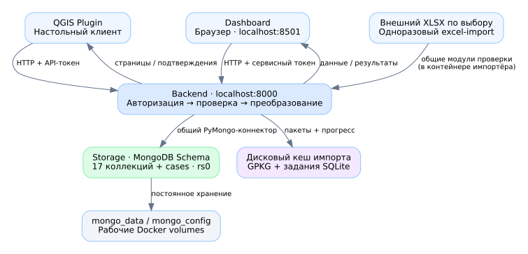

# GIS-MongoDB 0.11.2

> **Исправление импорта 0.11.1:** Excel читает все листы, JSON имеет отдельную
> команду. По умолчанию — только проверка; запись требует `--apply`.
> [Актуальные команды, Compass и диагностика](#import-version-20).
> Прежние разделы и описания форматов ниже сохранены.


**Новый автоматический импорт:** `py scripts/import_data.py "D:\Sources\file.xlsx"`.
Поддерживаются XLSX, JSON, GeoJSON и GPKG распознаваемых структур; требуется только
путь. [Инструкция 0.11](docs/AUTO_IMPORT_0110.md). Импорт независим от запуска;
схема, роли, данные и volumes сохраняются. Историческая неполнота и неоднозначные
ссылки явно отражаются в полном отчёте, без подстановки значений.


MongoDB хранит связанные документы, backend проверяет доступ, типы, связи и
геометрию, QGIS показывает и редактирует все 17 пользовательских коллекций,
Streamlit предоставляет dashboard. `cases` — дополнительная служебная коллекция.

**Проект запускается с пустой БД. Исходных датасетов в поставке нет.** Коллекции,
индексы, роли и replica set создаются независимо от импорта. Excel и GeoPackage
пользователь загружает отдельно, когда это требуется. Уже существующие документы
и Docker volumes при обновлении сохраняются.



## Первый запуск

Нужны Python 3.10+, Docker Engine/Desktop с Compose v2 и QGIS 3.28+ (проверен 3.40.6).
Из корня проекта в PowerShell:

```powershell
py scripts/manage.py doctor
py scripts/manage.py init
py scripts/manage.py volumes
py scripts/manage.py config --connections --local-api
py scripts/manage.py up --connections --local-api
py scripts/manage.py verify
py scripts/manage.py status
```

Linux/macOS: `python3` вместо `py`. `init` нужен только для новой установки.
Сохраните `.env`: там секреты и имена томов. Запуск не ищет A/B, manifest или папку
`data`, не собирает и не запускает импортёр. QGIS — настольное приложение:
установите `dist/qgis_mongodb.zip` через менеджер плагинов, перезапустите QGIS,
подключитесь к `127.0.0.1:8000` с подходящим API-токеном из `.env`.
Ожидаемая версия backend — `0.11.0`. Пустые слои/таблицы — нормальное состояние.

| Адрес | Назначение |
|---|---|
| http://127.0.0.1:8000/health/ready | Проверка технических подключений backend |
| http://127.0.0.1:8501 | Dashboard; пустая база поддерживается всеми ролями |

## Необязательный импорт

**GeoPackage:** кнопка «Загрузить файл .gpkg в MongoDB» в плагине → выбрать файл и
таблицу → сопоставить поля → выбрать строгий/частичный режим → проверить все строки
→ загрузить → сохранить полный CSV. Обработка геометрии/CRS остаётся в backend.
Размер пакета не ограничивает число строк файла. Поддерживается 2D Point и
непространственные таблицы, известная CRS преобразуется в EPSG:4326.

**Excel, новые строгие записи:** укажите путь к своему `.xlsx`. В выбранном листе
первая строка содержит целевые имена вида `Patient.passport`, `Patient.age`,
`Patient.reg_date`, `Instances.date`, `Therapy.date_start`, `Therapy.diagnosis`,
`Geodata.Longitude`, `Geodata.Latitude`. Одна строка — связанный набор; диагноз
можно записать JSON-массивом. Паспорт храните текстом, чтобы сохранить ведущие нули.

```powershell
py scripts/import_excel.py "D:\Sources\records.xlsx" --sheet Cases
py scripts/import_excel.py "D:\Sources\records.xlsx" --sheet Cases --apply > import-report.jsonl
```

Без `--apply` выполняется полная проверка с проверкой внешних ключей, без записи
документов. Для отдельных сущностей добавьте `--mode entities`; для частичного
импорта ошибочного файла — `--error-policy partial`. Полный отчёт JSONL выводится
в stdout; прогресс/ошибки команд Docker — в stderr. Служебный прогресс хранится
в прежнем томе импорта. Повтор неизменённого файла не создаёт дубликатов.

**Прежний Excel «лист — коллекция»:** отдельный исторический административный путь:

```powershell
py scripts/import_excel.py "D:\Sources\old.xlsx" --format collections --namespace test-dataset-a
py scripts/import_excel.py "D:\Sources\old.xlsx" --format collections --namespace test-dataset-a --historical --apply
```

Он сохраняет прежнее архивирование строк в `cases`, неполноту старых источников и
insert-only ID; это не строгий ввод новых записей. Сначала изучите его отчёт. Для
повторного импорта прежней базы сохраните прежний namespace; смена namespace
создаёт другую идентичность. Не используйте этот режим для обхода новых правил.
Исторический JSON-адаптер `seed_b` сохранён для явного административного вызова
с внешним файлом; автоматической загрузки JSON при запуске больше нет.

## Обновление существующей установки

Сохраните `.env` и все прежние volumes, замените файлы проекта, затем:

```powershell
py scripts/manage.py configure
py scripts/manage.py config --connections --local-api
py scripts/manage.py up --connections --local-api
py scripts/manage.py verify
py scripts/manage.py status
```

Переустановите ZIP плагина и перезапустите QGIS. Не выполняйте повторный `init`
или `down -v`. Источники A/B больше не нужны для запуска уже заполненной БД и
не удаляются из MongoDB. Индексы дополняются без удаления существующих.
Если датасеты были отслеживаемыми файлами вашего Git, уберите их из индекса
по [инструкции](docs/OPTIONAL_IMPORT_0100.md); исключение через `.gitignore` само
по себе не удаляет уже отслеживаемые файлы и старые коммиты.

## Правила и границы

- Все 17 коллекций доступны QGIS с пагинацией без общего лимита. Права прежние:
  user читает/редактирует своё, guest не видит Social_group/Street/Building/Placement,
  reader анализирует всю базу и остаётся только для чтения.
- Никаких фиктивных значений и скрытых пропусков. Критические ошибки останавливают
  оба режима импорта; необязательные поля дают предупреждение.
- В строгом режиме ошибки полной предварительной проверки запрещают запись.
  При позднем сбое уже подтверждённые строки остаются; общей транзакции файла нет.
- Кеш внешних ключей действует только внутри страницы проверки, ограничен памятью
  и не используется при записи: права и ссылки проверяются повторно.
- Ответы выдаются страницами с байтовыми границами. QGIS хранит полный загруженный
  слой, а dashboard аналитика — всю выборку; память клиентов растёт с объёмом.

## Документация и тесты

| Документ | Содержание |
|---|---|
| [Эксплуатация](docs/OPERATIONS.md) | Архитектура, права, развёртывание, обслуживание и backup |
| [Студенту](docs/STUDENT_GUIDE.md) | Пошаговая работа и движение данных |
| [Необязательный импорт](docs/OPTIONAL_IMPORT_0100.md) | Форматы Excel, пути, продолжение, Git и пустая установка |
| [Справочник скриптов](docs/SCRIPT_REFERENCE.md) | Назначение модулей и команд |
| [Политика ошибок](docs/GPKG_ERROR_POLICY_090.md) | Строгий/частичный режим, полный отчёт, безопасный повтор |
| [Отчёт об оптимизации](tests/OPTIMIZATION_0100.md) | Методика, измерения до/после и границы проверки |
| [Руководства HTML](docs/MANUAL.html) | Локальная версия с иллюстрациями |

```powershell
py -m pip install -r backend/requirements.txt
py scripts/manage.py test
py scripts/check_project.py
```

Для JS-проверок нужен Node.js. Интеграционные тесты с записью запускайте на отдельной
одноразовой установке. Результаты сравнения и нагрузочного теста находятся в
`tests/performance/`; они относятся к указанному синтетическому сценарию, а не
гарантируют одинаковое ускорение на любом сервере. Полный запуск Docker-контейнеров
в среде разработки недоступен; конфигурация Compose и нативные MongoDB/backend/QGIS
проверены отдельно, подробности — в отчёте.


<a id="import-version-20"></a>

## Исправление Version_20 / 0.11.1: автоматический Excel и JSON

Этот раздел задаёт актуальные команды; прежние разделы выше сохранены.
**`import_excel.py` обрабатывает все листы**, `--sheet Cases` не нужен.
**`import_json.py` добавлен** для `testB_normalized_final.json`.
Обе команды используют общий `import_launcher.py` и backend `auto_import.py`.
Без `--apply` выполняется только предварительная проверка, без записи MongoDB.

### 1. Подготовка и выбор файла

Откройте PowerShell в корне GIS-MongoDB, где находится docker-compose.yml.
Сохраните прежний `.env`, STORAGE_DATA_VOLUME/STORAGE_CONFIG_VOLUME и том импорта.
Для уже установленной базы не выполняйте init и down -v. Запустите сервисы:

```powershell
py scripts/manage.py up --connections --local-api
py scripts/manage.py verify
py scripts/manage.py status
```

Для совершенно новой установки сначала выполните первоначальные шаги README.
Импорт всегда отдельный и добровольный. Файлы находятся вне проекта; их не нужно
копировать в data или Git. Укажите полный путь в кавычках, например:
`C:\Users\User\Downloads\data\test_data.json`.
Docker Desktop должен иметь доступ к выбранному файлу. Linux/macOS: python3 вместо py.

### 2. Excel: проверить все листы и затем записать

```powershell
py scripts/import_excel.py "D:\Sources\test_datasetA.xlsx" --dry-run > import-excel-check.jsonl
py scripts/import_excel.py "D:\Sources\test_datasetA.xlsx" --apply > import-excel-apply.jsonl
```

Имя файла может быть test_datasetA_ispr_1.xlsx или другим: структура определяется
по именам листов/полей. Первая строка каждого листа — заголовки. Имена известных
коллекций сопоставляются с model.json, дополнительные исходные листы архивируются
в cases с предупреждением, не удваивая нормализованных пациентов. Формат всех
листов образца A не требует ни --sheet, ни --format, ни --historical.

### 3. JSON: проверить и записать

```powershell
py scripts/import_json.py "D:\Sources\testB_normalized_final.json" --dry-run > import-json-check.jsonl
py scripts/import_json.py "D:\Sources\testB_normalized_final.json" --apply > import-json-apply.jsonl
```

Распознаются разделы Patient/Therapy/Instances/Location/Foci, Address_Refs и
справочники образца B. Создаются только реально представленные сущности;
не нужно искусственно наполнять все 17 коллекций, если части данных отсутствуют.
Обе команды без указания режима эквивалентны --dry-run. Одновременные --dry-run
и --apply отклоняются до запуска Docker.

После проверки откройте отчёт, изучите severity=critical/error и предупреждения,
затем отдельно выполните ту же команду с --apply. Между вызовами применяются
те же правила, но проверка выполняется заново, а не по устаревшему разрешению.
Это исторический совместимый импорт: отсутствие паспортов/возраста и неоднозначные
однозначные FK отражаются в отчёте; проверки интерактивного API остаются строгими.
Смысл таких исключений подробно описан в docs/AUTO_IMPORT_0110.md.

### 4. ID, связи, геометрия и отчёт

MongoDB использует `_id` типа ObjectId. Корректные 24-символьные ID JSON
преобразуются в BSON ObjectId без смены значения. Числовые ID Excel и их FK
преобразуются согласованно прежним алгоритмом namespace test-dataset-a.
`id_instance`/`_id_instance` корректно связываются с Instances.instance и
Foci.id_instance. Geodata.geometry создаётся как Point в порядке долгота, широта.
Даты, числа, bool и массивы приводятся по model.json.

--dry-run создаёт только локальный служебный план и отчёт: не вставляет документы,
не обновляет существующие и не архивирует строки в cases. Итог status=dry-run,
documents показывает планируемые количества, inserted пустой. --apply вставляет
пакетами по 250, сохраняет прежние документы/правки и архивирует источник в cases.
Повтор неизменённого файла с --apply не создаёт дубликатов; итог inserted равен 0.
Совпадающие существующие ID не перезаписываются, даже если исходник изменился.

Отчёт JSONL: каждая строка — JSON-сообщение с stage, collection, row, field,
reason, severity; последняя строка содержит summary. issues включает и warnings.
Проверка исторического источника может закончиться с предупреждениями/ошибками
отдельных полей: они не становятся фиктивными значениями. Исходные значения при
--apply сохраняются в cases. Конфликт ID/неисправимая геометрия/повреждение файла
останавливают процесс. Код завершения доступен в PowerShell как `$LASTEXITCODE`.
Общего отката файла при позднем сбое записи нет; повтор дозаполняет отсутствующие ID.

### 5. Проверка в MongoDB Compass

Подключитесь с существующей строкой подключения и учётной записью с нужными правами.
Если локальный порт MongoDB не опубликован, используйте штатный локальный overlay,
описанный в разделе подключения; порт backend 8000 не является портом MongoDB.
Откройте Schema, нажмите Refresh и проверьте коллекции Patient, Instances, Therapy,
Geodata, Location, Foci и cases. Не удаляйте базу перед проверкой повторного импорта.

Подготовка подключения к `storage-1` через MongoDB Compass
```powershell
docker compose -p gis-mongodb -f docker-compose.yml -f docker-compose.compass.yml up -d --no-deps storage
```

Подключитесь к `storage-1` в монгокомпас по URL в MongoDB Compass
```javascript
mongodb://storage_admin:<<PASSWOED>>@127.0.0.1:27018/?authSource=admin&directConnection=true
```

В Compass встроенном mongosh выполните:

```javascript
use Schema
db.Patient.countDocuments({})
db.Instances.countDocuments({})
db.Geodata.countDocuments({})
db.Geodata.countDocuments({"geometry.type":"Point","geometry.coordinates.1":{$exists:true}})
db.Geodata.findOne({}, {_id:1, Longitude:1, Latitude:1, geometry:1})
db.Instances.findOne({}, {_id:1, instance:1, patient:1, therapy:1, date:1})
```

Вкладка Documents принимает только фильтры, не команду db.collection.find().
Там можно проверить отсутствующую геометрию фильтром:

```json
{"$or":[{"geometry":{"$exists":false}},{"geometry":null}]}
```

Для основной связи во вкладке Aggregations коллекции Foci используйте pipeline:

```json
[
 {"$match":{"id_instance":{"$exists":true}}},
 {"$lookup":{"from":"Instances","localField":"id_instance","foreignField":"instance","as":"target"}},
 {"$match":{"target":{"$size":0}}},
 {"$limit":10}
]
```

Пустой результат означает отсутствие висячих проверяемых ссылок, но отдельно
проверьте отчёт на ссылки, которые не удалось перенести. Аналогично сопоставьте
Therapy.patient с Patient._id и Location.address.geodata с Geodata._id.
Сверяйте прирост с inserted из отчёта, а не с числом всех листовых строк Excel.
При базе без прежних данных оба предоставленных образца в тесте дали суммарно
41938 Patient/Instances и 18509 Geodata. В рабочей базе количества могут отличаться;
при --dry-run они должны оставаться неизменными.

### 6. Частые ошибки и совместимость

| Симптом | Что проверить / действие |
|---|---|
| can't open file scripts/import_json.py | Разверните весь новый архив и запускайте из корня проекта; файл теперь включён в поставку. |
| Требуется --sheet Cases | Установлен старый import_excel.py. В новой стандартной команде нет --sheet; импортируются все листы. |
| unrecognized arguments --sheet/--format | Это прежние параметры плоского records-формата. Он сохранён в scripts/import_excel_records.py; основной путь образца A их не использует. |
| Файл не найден | Проверьте полный внешний путь и кавычки вокруг пробелов; не копируйте путь с именем другого пользователя. |
| Docker daemon недоступен | Запустите Docker Desktop/Engine и повторите после готовности storage. |
| Read-only mount / Permission denied | Предоставьте Docker доступ к внешнему файлу; источник монтируется read-only, что ожидаемо. |
| MongoDB authorization failed | Сверьте прежний .env с действующей установкой и выполните verify; не генерируйте новые пароли поверх рабочей БД. |
| Ничего не появилось после проверки | Для --dry-run это ожидаемо; запись разрешает только явный --apply. |
| Повтор inserted=0 | ID уже существуют; импорт сохраняет существующие документы и правки. |
| Много warnings / пустые passport и age | Историческая неполнота источника; значения не выдумываются. Изучите полный JSONL-отчёт. |
| Конфликт Street.building и подобных ссылок | Модель допускает одно значение, а источник несколько. Неоднозначность отражается в отчёте и cases; произвольный выбор здания не выполняется. |
| Повреждён XLSX/JSON или неверная geometry | Исправьте источник и повторите проверку; не используйте очистку volumes как ремонт импорта. |

scripts/import_data.py остаётся общей командой для XLSX/JSON/GeoJSON/GPKG,
теперь также с --dry-run/--apply и безопасной проверкой по умолчанию. Для старого
строгого плоского Excel с заголовками Collection.field используйте
`scripts/import_excel_records.py FILE --sheet Cases [--apply]` — это отдельный
сохранённый инструмент, а не обязательная настройка импорта test_datasetA.xlsx.

Перед обновлением сохраните .env и резервную копию БД. Замените исходники,
пересоберите backend штатным up, переустановите ZIP плагина (версия 0.11.1).
Схема, права доступа, имена volumes и независимая инициализация не изменены.
Полный Docker-запуск зависит от вашей среды; фактические проверки новой версии
описаны в tests/IMPORT_CLI_0111.md.

## Version_21 / 0.11.2: временное хранилище и блокировки GPKG

Причина `sqlite3.OperationalError: database or disk is full`: служебный SQLite
и полный отчёт создавались в /tmp, а контейнер импортёра ограничивает этот tmpfs
256 МиБ. Теперь staging и отчёт используют GPKG_UPLOAD_DIR — существующий
дисковый том /var/lib/gis-imports. Имена MongoDB volumes, права и схема не меняются.
Кеш SQLite ограничен 2 МиБ; число строк файла размером пакета не ограничивается.

Команды прежние, данные остаются вне проекта:

```powershell
py scripts/import_excel.py "D:\Sources\test_datasetA.xlsx" --dry-run
py scripts/import_excel.py "D:\Sources\test_datasetA.xlsx" --apply
py scripts/import_json.py "D:\Sources\testB_normalized_final.json" --dry-run
py scripts/import_json.py "D:\Sources\testB_normalized_final.json" --apply
py scripts/import_data.py "D:\Sources\data.geojson" --apply
py scripts/import_data.py "D:\Sources\data.gpkg" --apply
```

При обновлении сохраните .env и все volumes, затем пересоберите импортёр обычной
командой импорта. Не используйте down -v, удаление данных или очистку volumes.
Проверьте свободное место Docker Desktop/диска командой `docker system df` и
размер доступного Docker disk image в настройках Desktop. Даже дисковому staging
нужно место для нормализованных данных, архива строк, индексов и отчёта — больше
размера сжатого XLSX. При физическом заполнении диска импорт всё равно остановится
с ошибкой; увеличение tmpfs не является исправлением недостатка места на хосте.

Источниковый итератор закрывается в finally до очистки staging: это закрывает
read-only SQLite-соединение GPKG даже при ошибке обработки. Служебное соединение
также закрывается до удаления временной папки. Это устраняет оставляемую импортёром
блокировку, приводящую к WinError 32. Если файл держит открытым QGIS/Compass/другая
программа, закройте соответствующий слой/процесс и повторите; чужой дескриптор
импортёр закрыть не может. Windows в этой среде отдельно не тестировался.

Для GeoJSON/GPKG также добавлены одноимённые команды:
`py scripts/import_geojson.py FILE --dry-run|--apply` и
`py scripts/import_gpkg.py FILE --dry-run|--apply`. Для плоских связанных записей
с Instances и Geodata/Region автоматически создаются Location и Foci.
Промежуточные исходные строки SQLite сжимаются без потерь; в MongoDB cases
они записываются в прежнем BSON-формате, без требования распаковки клиентом.

У консольного импортёра увеличен тайм-аут отдельной операции MongoDB до 30 секунд
(`IMPORT_OPERATION_TIMEOUT_MS` для прямого запуска). Прежний предел 3 секунды
срывал проверку существующих ID на полном архиве cases. Backend/QGIS по умолчанию
сохраняют прежние тайм-ауты. В summary добавлен фактический staging_bytes.

Лист test_dataset_a____2024 в образце A — дополнительная исходная таблица.
Он архивируется в cases, а Patient/Instances/Geodata и остальные именованные
листы отдельно распределяются по коллекциям. Сообщение «no known collection»
для этого вспомогательного листа не означало отказ всего импорта. Теперь оно
заменено одним предупреждением на лист, число строк указано в archive_only_rows.
Ошибки конкретных нормализуемых записей по-прежнему выводятся полностью.
