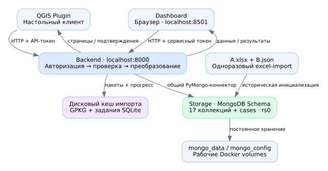

# GIS-MongoDB 0.8.0

Учебный ETL-проект: MongoDB хранит связанные данные, общий Python backend проверяет
доступ и выполняет операции, плагин QGIS работает со слоями/таблицами, Streamlit
предоставляет dashboard. Встроенные A+B загружаются при развёртывании.



## Документация

| Документ | Для кого и что внутри |
|---|---|
| [Общая инструкция по эксплуатации](docs/OPERATIONS.md) | Архитектура, движение данных, права, развёртывание, обслуживание, ограничения, резервирование |
| [Подробная инструкция для студента](docs/STUDENT_GUIDE.md) | Практикум с нуля: команды, ожидаемые результаты, QGIS, GPKG, консоль, правки и диагностика |
| [Справочник каждого скрипта](docs/SCRIPT_REFERENCE.md) | Назначение, запуск и влияние всех Python/JS/shell-файлов; активные и устаревшие пути |
| [Иллюстрированная версия для браузера](docs/MANUAL.html) | Все руководства в одном автономном HTML; SVG-схемы встроены, можно печатать |
| [Отчёт о проверке версии 0.8.0](tests/GPKG_BULK_080_VERIFICATION.md) | Что фактически проверено и что осталось неподтверждённым |

Документы описывают **реальное поведение 0.8.0**. Старые отчёты и заметки в docs/tests
оставлены как история. Их ограничения 1000 строк / 32 МиБ на весь GPKG больше
не относятся к новому пути импорта. Программный код и исходные данные этой
документационной поставкой не изменяются.

## Первый запуск — новая установка

Нужны Python 3.10+, работающий Docker Engine/Desktop с Compose v2 и QGIS 3.x
для плагина. Полная GUI-проверка выполнена с QGIS 3.40.6; минимальная заявленная
версия плагина — 3.28. Для самостоятельного запуска тестов нужен также Node.js.

Из папки с docker-compose.yml, PowerShell:

```powershell
py scripts/manage.py doctor
py scripts/manage.py init
py scripts/manage.py volumes
py scripts/manage.py config --connections --local-api
py scripts/manage.py up --connections --local-api
py scripts/manage.py verify
py scripts/manage.py status
```

Linux/macOS: замените `py` на `python3`. Не копируйте .env.example поверх созданного
.env. `init` создаёт собственные секреты и имена томов; `volumes` готовит тома
новой установки. Сохраните .env: без него нельзя надёжно продолжить работу с прежней БД.

## Обновление существующей установки

Сделайте резервную копию и сохраните прежний .env вместе с именами томов.
Замените файлы проекта, оставьте прежний .env в корне и выполните:

```powershell
py scripts/manage.py configure
py scripts/manage.py config --connections --local-api
py scripts/manage.py up --connections --local-api
py scripts/manage.py verify
```

Не повторяйте init и не используйте `down -v`. Новые имена томов могут привести
к запуску пустой БД вместо старой. configure дописывает отсутствующие секреты,
но не исправляет ошибочно введённый существующий пароль и не заменяет старые значения.

## Адреса и вход

| Интерфейс | Адрес / учётные данные |
|---|---|
| Dashboard | http://127.0.0.1:8501; пароли ROLE_READER_PASS / ROLE_USER_PASS / ROLE_GUEST_PASS |
| QGIS → backend | Хост 127.0.0.1, порт 8000; API-токен выбранного профиля |
| Готовность backend | http://127.0.0.1:8000/health/ready |
| Версия backend | Показывается при подключении плагина: ожидается 0.8.0 |

| Профиль QGIS | Переменная токена | Доступ через API |
|---|---|---|
| qgis-user | QGIS_USER_TOKEN | Свои документы: чтение, создание, изменение |
| analyst | DASHBOARD_TOKEN | Все 17 коллекций, только чтение |
| guest | QGIS_GUEST_TOKEN | Чтение 13 коллекций; закрыты Social_group, Street, Building, Placement |
| admin | QGIS_ADMIN_TOKEN | Чтение/создание/изменение документов всех владельцев |

Пользовательское удаление документов и изменение схемы API не предоставляются,
включая профиль admin. Техническое администрирование storage_admin — отдельный канал.
Пароль dashboard, API-токен и пароль MongoDB — три разных вида секретов.

## QGIS: короткий маршрут

1. Установите dist/qgis_mongodb.zip через менеджер модулей → установку из ZIP.
2. Перезапустите QGIS и откройте **MongoDB Data Loader**.
3. Введите подключение, профиль и соответствующий токен; нажмите «Подключиться».
4. Отметьте коллекции и загрузите. Geodata — Point EPSG:4326, остальные — таблицы.
   Все страницы коллекции загружаются автоматически; пустые таблицы тоже добавляются.
5. Для изменения используйте обычный буфер правок QGIS и сохранение либо JSON-форму.
   Для создания — форму нового связанного набора или импорт GPKG.
6. Для GPKG выберите файл/таблицу, сопоставьте поля, дождитесь проверки **всех** строк,
   затем нажмите загрузку. Прогресс можно продолжить после прерывания.
7. Консоль принимает, например, `db.Patient.countDocuments({})` и
   `db.Geodata.find({"geometry.type": "Point"}).limit(10)`.

Обновляйте backend и плагин вместе. Только переустановка ZIP не обновляет Docker-образ.
После восстановления geometry заново загрузите Geodata: memory cache QGIS не
перечитывается автоматически.

## Импорт и сохранность

- У GPKG нет общего программного лимита строк/размера нового файла: блок передачи
  ≤4 МиБ, проверка ≤250 строк, запись ≤25 строк — это размеры шагов, а не всего файла.
- Есть ограничения формата/отдельных атрибутов, диска и времени; подробности в руководстве.
- До успешной проверки всех строк импорт в MongoDB не начинается. Затем транзакция
  охватывает одну исходную строку и её связи; весь файл не является одной транзакцией.
- Повтор идентичного ввода не создаёт повторные документы по тем же ID. Другое
  содержимое файла или другие PK не являются автоматической смысловой дедупликацией.
- Встроенные A+B загружаются insert-only; прежние правки не заменяются. `cases` —
  дополнительный архив исходных строк и маркеров, а не одна из 17 пользовательских коллекций.
- Рабочие тома: mongo_data, mongo_config. Дополнительный том
  `<STORAGE_DATA_VOLUME>_imports` хранит GPKG и служебные задания, не документы MongoDB.

## Обслуживание и проверки

```powershell
py scripts/manage.py status
py scripts/manage.py logs
py scripts/manage.py geometry
py scripts/manage.py stop
```

`logs` показывает storage. Для backend/dashboard: `docker compose --profile connections logs --tail 100 backend dashboard`.
Повторный запуск — команда up с теми же .env и томами. Папка storage/backup сама
не создаёт резервных копий; порядок копирования описан в общей инструкции.

```powershell
py -m pip install -r backend/requirements.txt
py scripts/manage.py test
py scripts/check_project.py
py scripts/manage.py integration
```

integration требует Docker и использует собственный случайный проект/тестовые тома.
Не запускайте остальные пишущие integration-сценарии против рабочей БД.
В 0.8.0 подтверждены 88 unit-тестов, настоящий импорт 5003 строк из GPKG 43,6 МБ,
возобновление после перезапусков и заполненная geometry 18509 исходных Geodata.
Docker socket в среде подготовки недоступен: Compose config проверен, запуск
образов/контейнерной сети здесь не подтверждён. Полное описание — в отчёте версии.
