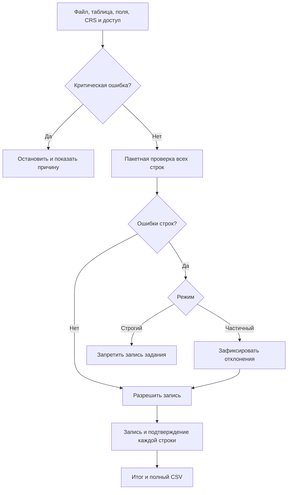

# GeoPackage: ошибки, режимы и повтор — версия 0.9.0

## Выбор режима в QGIS

Установите `dist/qgis_mongodb.zip` из этой версии и полностью перезапустите QGIS.
Подключитесь под пользователем с правами записи, откройте импорт GeoPackage,
выберите файл, таблицу, поля и способ обработки ошибок. Это отдельный выбор от
«Отдельные коллекции / Полный связанный набор»: частичное сопоставление полей и
частичный импорт ошибочного файла — разные настройки.

| Ситуация | Строгий, по умолчанию | Частичный |
|---|---|---|
| Повреждение файла, отсутствующая обязательная колонка или её сопоставление, неизвестная CRS | Остановка до записи | Остановка до записи |
| Ошибка значения, типа, Point-геометрии или внешнего ключа в строке при проверке | Проверить весь файл; запись всего задания запрещена | Отклонить всю строку, записать остальные после проверки всего файла |
| Отсутствующее необязательное поле или NULL | Предупреждение | Предупреждение |
| Недоступность MongoDB, ошибка дискового хранилища, недостаточные права | Остановка, строка не пропускается | Остановка, строка не пропускается |
| Новая ошибка строки уже при записи, например изменившийся внешний ключ | Остановка на этой строке | Явное отклонение строки с отчётом, продолжение |

Если не осталось корректных строк, кнопка записи недоступна в обоих режимах.
Отсутствующий обязательный столбец — критическая ошибка конфигурации; NULL или
неправильное значение в существующем обязательном столбце — ошибка конкретной строки.
Фиктивные даты, нулевой возраст, произвольные ключи и координаты не подставляются.

## Что именно проверяется

Обязательные поля и типы берутся из `storage/schema/model.json` и бизнес-правил
`entities.REQUIRED`. Для выбранных сущностей проверяются все обязательные атрибуты,
а для полного набора — все четыре группы данных. Отсутствующие необязательные
коллекции не создаются. Ключи генерирует backend; связи между документами одной
строки проверяются совместно, а ссылки на существующие документы — с учётом роли
и владельца. Отклонённая строка не оставляет часть своих связанных документов.

Пространственный импорт поддерживает **2D Point**. Backend проверяет GPKG/WKB,
совпадение CRS заголовка с таблицей, известность CRS, преобразование в EPSG:4326,
конечность и диапазон координат, согласованность `Longitude`, `Latitude` и
`geometry`. Неизвестная CRS не заменяется предположением EPSG:4326. Если используются
координатные столбцы вместо геометрии, они должны соответствовать принятой схеме
EPSG:4326. Линии/полигоны не превращаются молча в центроиды. Адрес без координат
не превращается в выдуманную точку.

## Запись, остановка и безопасное продолжение

До проверки последней строки MongoDB не изменяется этим заданием. Далее связанные
документы **одной строки** записываются транзакционно. Общей транзакции на весь
файл и автоматического отката уже подтверждённых строк нет. При сбое после начала
записи они остаются в MongoDB и отражаются в счётчиках. Это относится и к строгому
режиму. Исходные документы не удаляются и не перезаписываются ради отката.

После восстановления MongoDB или связи нажмите «Продолжить прерванный импорт».
Сервер продолжает то же задание с сохранённой позиции. При недостаточных правах,
повреждении файла или ошибках данных сначала исправьте причину; автоматически
пропускать проблемную строку нельзя. Исправленный файл проверяется новым заданием.

ID вычисляются детерминированно из SHA256 файла, таблицы и исходного первичного
ключа. Повтор того же задания/файла с тем же содержимым не создаёт повторных
документов. Потеря ответа после успешной MongoDB-транзакции также допускает повтор.
Служебный `_ingest_job` добавляется только новым документам и позволяет восстановить
счётчики после потери подтверждения. Он скрыт в публичных данных и консоли.
Совпадение ID при другом владельце/содержимом считается конфликтом.
Это не объединение людей по паспорту: изменившийся файл имеет другую идентичность.
Не перезагружайте изменённую копию как способ продолжения старого задания.

Служебные GPKG/SQLite-файлы привязаны к пользователю/роли, сохраняются в томе
импорта и доступны до истечения срока хранения (по умолчанию 7 дней неактивности).
Очистка этого кеша не удаляет документы MongoDB. Если исходный файл исчез,
продолжение блокируется, а сохранённый отчёт остаётся доступен до истечения задания.

## Отчёт

Нажмите **«Сохранить полный отчёт CSV»**. В интерфейсе выводятся первые 100 ошибок,
но CSV выгружает все страницы, включая предупреждения. Число 100 ограничивает
только предварительный просмотр, а не обработку файла или итоговый отчёт.

| Поле | Значение |
|---|---|
| severity | critical / error / warning |
| stage | upload, structure, mapping, crs, connection, validation, write, authorization; network для сбоя клиента |
| row | Номер строки с 1 в стабильном порядке исходного PK; пусто для ошибки всего задания |
| source_key | Исходный PK, когда доступен |
| field | Например Patient.age, Therapy.patient, Geodata.geometry |
| code / reason | Машинный код и объяснение |
| retryable | Допустимо повторить то же задание после восстановления инфраструктуры |

Сводка различает `checked`, `valid_rows`, `failed_rows`, `position`,
`successful_rows`, `documents_present`, `documents_created_by_job`,
`documents_reused` и `by_collection`. Одна строка может создавать несколько документов;
«успешных строк» и «подтверждённых документов» нельзя приравнивать. `position`
в частичном режиме включает явно отклонённые строки; это не число успешных записей.
История критических ошибок сохраняется даже после успешного продолжения.

При ошибке до создания задания CSV содержит локальную диагностику и нулевые
счётчики. Сохраняйте отчёт до исправления полей/выбора другого файла: смена
конфигурации начинает новую проверку. Отчёт может содержать исходные ключи и
сообщения валидации, поэтому обращайтесь с ним как с данными проекта.

## API и модули

`POST /v1/gpkg/jobs` принимает `error_policy: strict|partial`; без поля — strict.
`POST .../{job_id}/validate` проверяет до 250 строк за запрос, `POST .../apply`
применяет до 25, с дополнительными байтовыми границами. Общего лимита строк нет.
`GET .../{job_id}` возвращает состояние, а `GET .../{job_id}/report?after=0&limit=100`
возвращает полную сводку и страницу диагностики (`next` до `null`, максимум 500
элементов на страницу). Доступ — только владельцу задания с подходящей ролью.
Старые `/validate` и `/apply` сохраняют строгий режим; для partial нужен jobs API.

| Модуль | Ответственность |
|---|---|
| gpkg_errors.py | Единый формат и классификация ошибок |
| gpkg_uploads.py | Передача частями, SHA256, структура, владение, хранение |
| gpkg_import.py | Сопоставление, CRS, чтение по PK, преобразование одной строки |
| gpkg_jobs.py | Политика, состояния, SQLite-прогресс, полный отчёт, подтверждения |
| entities.py / records.py | Бизнес-правила, типы, ссылки, ID и транзакционная запись |
| qgis_plugin/gpkg_dialog.py | Выбор режима, кнопки, продолжение и выгрузка CSV |

## Обновление и проверка

Следуйте [UPGRADE.md](UPGRADE.md): сохраните прежний `.env` и все Docker volumes,
обновите backend и плагин вместе. Не применяйте `down -v`, повторный `init` или
сброс БД. В 0.10.0 существующие A+B в БД и миграции сохраняются; сами исходники исключены
из поставки, импорт больше не является частью запуска. См. OPTIONAL_IMPORT_0100.md.
Фактические проверки: [отчёт версии 0.9.0](../tests/GPKG_POLICY_090_VERIFICATION.md).
