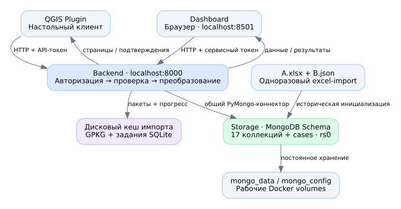
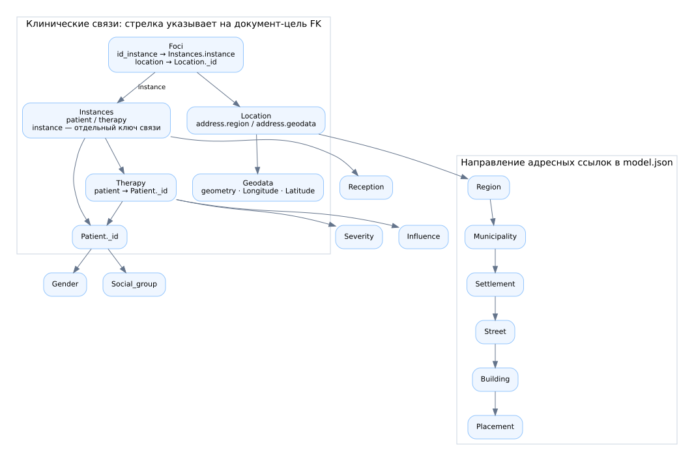
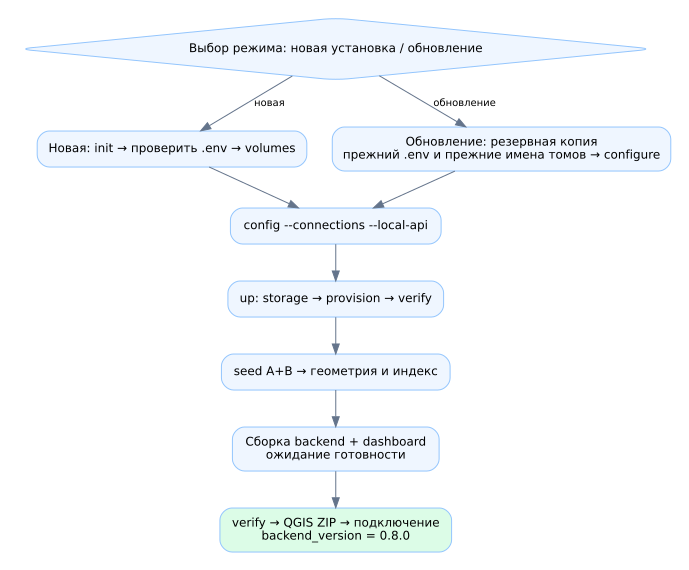
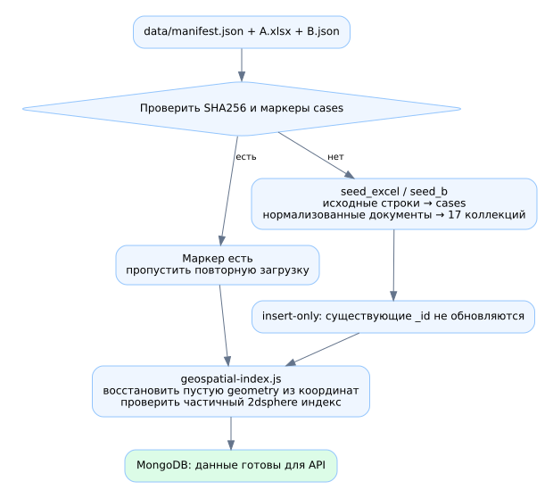
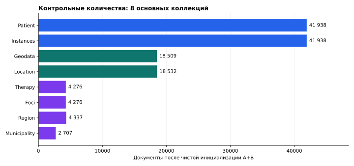
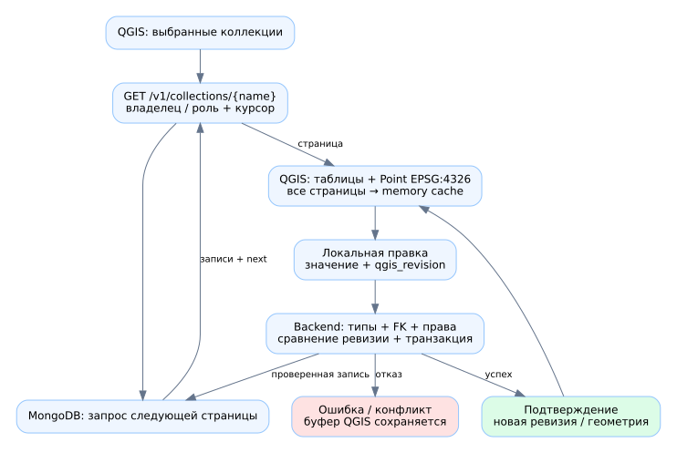
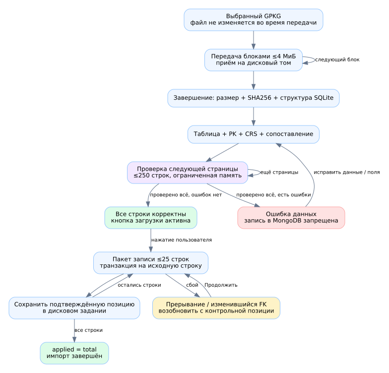
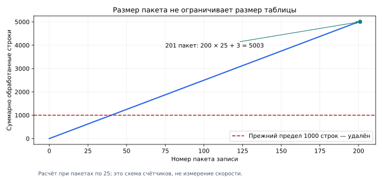

# Инструкция по эксплуатации GIS-MongoDB 0.8.0

Редакция документации: 11.11.2026. Руководство описывает текущую реализацию,
а не первоначальный проектный замысел. [README](../README.md) — быстрый вход;
[практикум](STUDENT_GUIDE.md) — подробные действия; [скрипты](SCRIPT_REFERENCE.md)
— устройство исходного кода. Автономная иллюстрированная версия: [MANUAL.html](MANUAL.html).

## 1. Назначение и основной принцип

Проект связывает нормализованные документы MongoDB с настольной ГИС и dashboard.
Пользователь формулирует действие в QGIS либо браузере. Backend определяет
проверенную сервером роль, проверяет атрибуты и ссылки, выполняет чтение/запись
в MongoDB и возвращает данные в пригодном для клиента виде. Клиент не получает
пароли технических пользователей БД и не меняет model.json.



В раннем описании использовались отдельные download/upload. В текущей поставке
эти функции объединены в backend/app/modules. Обслуживание ведётся для storage,
backend, dashboard и одноразового excel-import. QGIS устанавливается на компьютер
пользователя; это не контейнер. В схемах стрелки API означают запрос и ответ,
а не копирование всей БД при каждом действии.

| Компонент | Что делает | Чего от него не следует ожидать |
|---|---|---|
| storage | MongoDB Schema, валидаторы, индексы, пользователи, rs0 | Автоматического исправления любых пользовательских ошибок данных |
| backend | Общий коннектор, авторизация, страницы, импорт, геометрия, синхронизация | Произвольного Python/JavaScript из консоли клиента |
| dashboard | Фильтры, карта, графики, журнал и запросы через backend | Прямого соединения браузера с MongoDB |
| QGIS Plugin | Диалоги, загрузка таблиц/точек, редактор и передача правок | Постоянного автономного хранилища вместо MongoDB |
| excel-import | Начальная загрузка встроенных A+B | Постоянно работающего сервера и произвольного интерактивного импорта Excel |
| Дисковый кеш GPKG | Части файла, проверенные строки, позиции задания | Замены прикладных коллекций MongoDB |

Геометрия импортируемого файла читается и преобразуется в backend через pyproj.
QGIS декодирует уже подготовленные WGS84 GeoJSON/WKT. Проектная CRS карты QGIS
может отличаться от CRS слоя; перепроецирование отображения карты само по себе
не меняет сохранённые в MongoDB координаты.

## 2. Где находятся данные

| Место | Содержимое | Как сохранять |
|---|---|---|
| data/test_datasetA.xlsx | Неизменённый источник A | Вместе с проектом; SHA256 в manifest.json |
| data/testB_normalized.json | Неизменённый источник B | Вместе с проектом |
| Schema: 17 коллекций | Нормализованные документы и ссылки | mongodump/проверенная процедура восстановления |
| Schema.cases | Исходные строки, происхождение, маркеры seed | В составе копии БД |
| mongo_data | Файлы рабочей MongoDB | Не удалять при обновлении |
| mongo_config | Конфигурационные данные и replica.key | Сохранять с установкой; не публиковать |
| .env | Секреты, имена томов, параметры установки | Отдельная защищённая копия; не Git |
| gpkg_uploads | Временные файлы и служебные SQLite-задания | Нужен для продолжения незавершённого импорта |
| QGIS memory layers | Локально загруженные страницы и буфер правок | Сохранить изменения в backend; при новом сеансе перечитать коллекции |

Имена томов задают STORAGE_DATA_VOLUME и STORAGE_CONFIG_VOLUME. Имя дополнительного
тома импорта образуется как `<STORAGE_DATA_VOLUME>_imports`. Новая пустая папка
проекта не означает новую БД, если она использует прежние имена томов. И наоборот:
новый .env с другими именами может открыть пустую БД вместо существующей. Не
подключайте два mongod к одному рабочему тому одновременно.

## 3. Схема и связи

model.json — единственный канонический файл BSON-схем. Названия: Instances, Region,
Municipality, Settlement, Street, Building, Placement, Reception, Geodata, Patient,
Gender, Social_group, Therapy, Severity, Influence, Foci, Location. cases — отдельный
служебный архив, поэтому физически после инициализации можно видеть 18 коллекций.



Стрелка указывает от поля-ссылки к целевому документу. Не переосмысливайте адресные
ссылки как обратные: именно Region.municipality → Municipality._id, затем
Municipality.settlement → Settlement._id и далее по схеме. Критическая особенность:
Foci.id_instance ссылается на **Instances.instance**, а не просто на _id по догадке.
Location.address.geodata указывает на Geodata; Patient сам по себе не содержит точку.

Новые _id и связанные значения генерируются backend. _owner_id ограничивает
пользовательские документы; qgis_revision позволяет обнаружить конкурентную правку.
_request_hash обеспечивает проверку повторного запроса. Эти метаданные не являются
полями, которые пользователь должен сопоставлять с GPKG.

Историческая схема допускает неполноту исходных данных. Поэтому обязательность
нового пользовательского ввода задаётся одновременно model.json и бизнес-правилами
records/entities. В GPKG список требований приходит из backend; нельзя считать,
что required только с _id означает возможность создать пустого нового пациента.

## 4. Развёртывание и обновление



### 4.1. Новая учебная установка

Рабочая папка должна содержать docker-compose.yml, backend, storage, dashboard,
data и scripts. Запустите Docker. В корне выполните doctor, затем init, volumes,
config --connections --local-api, up --connections --local-api, verify и status.
Точные команды приведены в README и практикуме. При первом запуске нужны сеть для
получения образов/зависимостей, свободный диск под MongoDB и исходные файлы.

init выполняют один раз: существующий .env он не перезаписывает. volumes — явная
подготовка новой установки. Compose использует external:false и способен создать
отсутствующий именованный том; при обновлении это не доказывает, что подключён
нужный прежний том. Всегда сверяйте имена до запуска.

### 4.2. Что делает up

1. Проверяет, не используются ли тома старым работающим MongoDB-сервисом.
2. Останавливает backend на время подготовки хранилища.
3. Запускает storage и ждёт контейнерной готовности.
4. provision настраивает replica set, схему, роли, индексы и подготовку геометрии.
5. verify проверяет фактическую схему, права и служебные подключения.
6. Собирает одноразовый excel-import и запускает seed для A+B.
7. Повторно проверяет/дополняет геометрию и пространственный индекс.
8. С --connections собирает backend/dashboard и ждёт их готовности.

Контейнер storage Healthy означает доступность окончательного mongod и ping.
Это отличается от корректности всех ролей/валидаторов и от заполнения источников.
Для прикладной проверки нужны verify и успешный seed. Backend /health/ready отдельно
проверяет свои технические подключения; /health/live сообщает только о живом процессе.

### 4.3. Обновление

Остановите пользовательские изменения и сделайте копию. Сохраните прежний .env,
точные имена data/config-томов и нужный кеш незавершённого импорта. Разверните новые
файлы поверх версии проекта, верните .env, выполните configure → config → up → verify.
Перезапустите QGIS после переустановки ZIP. Сравните backend_version с 0.8.0.
Не заменяйте .env шаблоном и не используйте init для ремонта старых паролей.

Обычный up — полноценный запуск с подготовкой/seed и сборкой, а не только лёгкий
restart. Он может занять время. Миграцию старых опечаток выполняют отдельно через
migrate-plan и migrate; эти команды останавливают backend и автоматически не
возвращают весь интерфейс в работу — после них нужен обычный up.

## 5. Историческая инициализация A+B



seed.py читает manifest.json, сверяет SHA256 и ищет маркеры `bundled-seed:<digest>`
в cases. При отсутствии маркера вызывается соответствующий загрузчик. Исходные
строки архивируются, документы создаются insert-only: существующие _id не
обновляются. Маркер добавляется после успешного этапа. После частичного сбоя
повтор помогает дозагрузить отсутствующие документы, сохраняя имеющиеся.

Пропуски источников не выдумываются: паспортов нет в исходном наборе, возраст
части B отсутствует. Это исторический bootstrap, а не исключение, которым
пользователь может обходить строгий интерактивный ввод.



График показывает восемь основных коллекций после чистой A+B, не скорость сервера.
Контрольные числа: Patient/Instances по 41938, Geodata 18509, Location 18532,
Therapy/Foci по 4276, Region 4337, Municipality 2707. В cases — 146107 исходных
строк и две служебные метки. После пользовательских импортов эти числа растут;
после фильтрации/смены роли видимая выборка может быть меньше.

geospatial-index.js выполняется и при уже существующих маркерах. Поэтому
восстановление пустой geometry не требует удалять источник или запускать init.
Валидная новая geometry — `{type:"Point",coordinates:[Longitude,Latitude]}`;
порядок всегда долгота, широта. Отсутствующая/null/пустая geometry восстанавливается
только при корректных координатах. Прежнее пустое значение сохраняется в
_previous_geometry; непустая ошибочная геометрия не переписывается молча.
Частичный индекс gis_valid_geometry включает только помеченные валидные точки.

## 6. Доступ и секреты

В QGIS имя само по себе не предоставляет права. Backend сопоставляет Bearer-токен
и при наличии X-GIS-User проверяет имя. Переключение профиля сбрасывает прежние
управляемые слои/каталог и повторно получает права. Несохранённый локальный буфер
нельзя терять незаметно: пользователь решает, сохранить его или отменить.

| Уровень | Пример | Кому выдавать |
|---|---|---|
| Пароль dashboard | ROLE_READER_PASS | Пользователю соответствующего браузерного профиля |
| API-токен | QGIS_USER_TOKEN | Клиенту QGIS этой роли/владельца |
| Технический пароль MongoDB | USER_PASSWORD, PROCESSOR_PASSWORD | Только серверным компонентам |
| Пароль root MongoDB | MONGO_ROOT_PASSWORD | Администратору хранения/резервирования |

Профиль qgis-user по умолчанию общий, владелец qgis-user; это не отдельная личная
учётная запись каждого врача. Для индивидуальных владельцев администратор задаёт
QGIS_IDENTITIES_JSON. Пример структуры без пригодного секрета:

```json
[{"username":"student-a","token":"REPLACE_WITH_UNIQUE_RANDOM_TOKEN","role":"user","owner":"student-a"}]
```

Строка хранится в серверной конфигурации; в .env JSON можно заключить в одинарные
кавычки целиком. Не используйте пример токена как пароль. Профиль admin API
читает/создаёт/правит всех владельцев, но API не реализует удаление документов и
DDL. storage_admin/root и техническая роль gis_admin относятся к администрированию
MongoDB; их полномочия нельзя переносить на браузерный admin по совпадению слова.

## 7. Выгрузка и редактирование QGIS



Клиент запрашивает каталог доступных коллекций, затем страницы /v1/collections.
Курсор основан на _id; _key представляет идентификаторы разных BSON-типов без
неоднозначного преобразования. Размер ответа — не предел коллекции: загрузчик
проходит все next. Decimal128/Binary и сложные значения передаются в совместимом
JSON/Extended JSON; служебные поля скрываются.

Geodata становится Point EPSG:4326; остальные коллекции становятся таблицами без
геометрии. Даже пустая таблица имеет поля схемы. Клиент хранит локальный memory
cache. После открытия сохранённого QGIS-проекта данные нужно получить заново:
проект не превращает этот кеш в постоянный MongoDB provider.

При сохранении backend проверяет роль, владельца, типы, обязательность изменяемых
полей, FK и ревизию. Успех возвращает новую ревизию и согласованные координаты/
geometry; отказ сохраняет буфер для исправления. Пакет до 200 правок атомарен;
несколько пакетов одного слоя — не одна общая транзакция. При частично выполненных
пакетах сначала выясните подтверждённое состояние, не предполагая откат всего слоя.
Создание/удаление строк непосредственно memory provider отключено: создавайте через
форму либо импорт; пользовательское удаление документов не предоставлено.

Экспорт в GPKG выполняется штатным «Сохранить объекты как…» QGIS для каждой
таблицы/слоя. Пространственная геометрия слоя и строковый атрибут geometry — разные
сущности. При повторном импорте выбирайте реальный Point-столбец GPKG через флажок,
а не пытайтесь сопоставить текстовый JSON в geometry вместо геометрии таблицы.

## 8. Новый связанный набор и GPKG

Полный набор требует все четыре группы: местоположение, Instances.date,
Patient.passport/age/reg_date, Therapy.date_start/diagnosis. Местоположение —
Longitude и Latitude вместе либо все описательные поля пяти адресных коллекций.
Location/Foci и ссылки создаёт backend. Полная адресная ветка может не создать
точку, если координаты не переданы: наличие адреса не означает выполненное геокодирование.

Для частичного GPKG обязательны поля **выбранных** сущностей, а не все атрибуты всех
17 коллекций. Therapy требует существующий доступный patient либо Patient той же
строки; Geodata может быть единственной сущностью при наличии Point. Для Region/
Municipality/Settlement/Street нужен name, для Building — house; точные требования
и типы приходят backend. Генерируемые _id/instance и метаданные не сопоставляются.



Передача идёт блоками ≤4 МиБ в отдельный дисковый том. Проверяются завершённость,
SHA256 и структура SQLite. После сопоставления создаётся дисковое задание.
Страницы читаются по PK, проверяются и складываются в служебный SQLite. До
проверки последней строки ни одна строка задания не импортируется в MongoDB.
Ошибки показываются с номерами; ответ ограничивает число описаний, а не число
проверяемых строк. Затем пользователь отдельно подтверждает запись кнопкой.

Импорт применяет до 25 строк за шаг, сохраняет позицию после каждой подтверждённой
строки. При сбое задания пользователь нажимает продолжение. После перезапуска
backend позиция берётся с диска, а не из догадки клиента. Повтор после потерянного
подтверждения использует те же ID. Это защита повторной доставки, а не поиск
одинаковых пациентов по ФИО/паспорту или одинаковых точек по координатам.



График — расчёт счётчика при пакетах по 25, не замер производительности. 5003 строки
могут потребовать 201 пакет. В действительности байтовая граница иногда уменьшает
пакет; сервер всегда сообщает реальную подтверждённую позицию.

Сессии привязаны к владельцу/роли. Не меняйте исходный файл во время передачи и
сопоставление после частичного импорта. Неактивный служебный кеш истекает через
7 дней; он очищается при начале последующих загрузок. Рабочие документы MongoDB
при этой очистке не удаляются. До завершения задания нужен диск и для GPKG,
и для подготовленных строк; это не только размер исходного файла.

## 9. Dashboard, консоль и границы выборки

Главный dashboard кеширует overview на 60 секунд; статистический endpoint имеет
свой кеш 15 секунд. После записи проверяйте MongoDB напрямую и учитывайте задержку
кеша перед обновлением браузерных показателей.

Главный dashboard строит связанные строки по Instances и показывает карту,
графики, журнал и экспорт. Аналитик проходит все страницы overview; user/guest
сохраняют интерфейсное ограничение 2500 обращений. Отсутствующий пациент/адрес
не превращается в выдуманную связь: интерфейс показывает неполные значения.

Полный анализ и количество точек на экране — разные вещи. В режиме отдельных
точек есть пользовательский экранный предел 1000–20000; кластеры получают все
подходящие геозаписи из загруженной выборки. Журнал листается по 100 строк.
Это не новые пределы GPKG или QGIS-коллекций.

| Канал | Граница / продолжение |
|---|---|
| QGIS коллекции | До 200 документов на страницу, целевая страница около 1,5 МБ; все next автоматически |
| Mongo-консоль QGIS | До 200 результатов на страницу; продолжение кнопкой, курсор 15 минут |
| Главный overview аналитика | Клиент проходит все страницы по 500; API допускает до 1000 на страницу |
| Структурная JSON/XML-консоль dashboard /v1/query | Явный limit 1–200; это отдельная ограниченная форма запроса |
| /v1/statistics | Агрегаты + независимая ограниченная карта до 5000 точек |
| Учебные /v1/tz-query | spatial/analytics сейчас берут одну стандартную страницу export_data, обычно 500; не трактовать как анализ всей БД |
| Новый GPKG | Общего лимита строк/байтов файла нет; защитные лимиты отдельных значений сохраняются |

Консоль QGIS разбирает безопасное подмножество MongoDB/Python-литералов, не выполняет
код компьютера пользователя. Поддержаны find, aggregate, countDocuments, distinct,
ObjectId/ISODate, /regex/i, db["Patient"] и getCollection. pretty/toArray не отменяют
постраничную передачу. $out/$merge/$where/$function/$accumulator запрещены; lookup
должен соблюдать область доступа. Для полных агрегатов используйте эту консоль
с подходящей ролью, а не делайте выводы о полноте старых демонстрационных модулей.

## 10. Операционный регламент

Перед началом дня проверьте Docker, status, /health/ready, доступ к нужной роли
и наличие резервной копии. После импорта дождитесь applied=total, проверьте
количества и несколько контрольных объектов, заново загрузите изменённые слои.
Перед обновлением приостановите записи и сохраните незавершённые пользовательские
правки. После работы используйте manage.py stop, а не удаление томов.

logs выводит только storage. Для приложения используйте
`docker compose --profile connections logs --tail 100 backend dashboard`.
Сохраняйте текст ошибки, версию backend/плагина, роль, этап, job_id и размеры файла.
Не отправляйте .env, токены, пароли или полные документы пациентов в общий чат/репозиторий.

## 11. Резервирование и восстановление

Каталог storage/backup — место для файлов, не планировщик резервного копирования.
Для рабочей установки администратор задаёт периодичность и срок хранения. Копия
должна включать БД, защищённый .env, конфигурацию установки и при необходимости
кеш активного импорта. Логический dump MongoDB не содержит служебные SQLite-задания.
Не копируйте файлы живого WiredTiger обычным файловым копированием.

Ниже — пример ручной логической копии при остановленных прикладных записях;
он не выполнялся в среде подготовки, поскольку Docker daemon недоступен.
Убедитесь, что в образе есть mongodump и достаточно места в /tmp контейнера.
При больших базах администратор выбирает отдельное хранилище копий.

На хосте из корня проекта:

```powershell
docker compose --profile connections stop backend dashboard
docker compose exec storage bash
```

Внутри Bash контейнера (это уже не PowerShell):

```bash
command -v mongodump
umask 077
mongodump --host 127.0.0.1 --port 27017 \
  --username "$MONGO_INITDB_ROOT_USERNAME" \
  --password "$MONGO_INITDB_ROOT_PASSWORD" \
  --authenticationDatabase admin --oplog \
  --archive=/tmp/gis-backup.archive.gz --gzip
exit
```

На хосте:

```powershell
$backupFile = ".\storage\backup\gis-" + (Get-Date -Format "yyyyMMdd-HHmmss") + ".archive.gz"
docker compose cp storage:/tmp/gis-backup.archive.gz $backupFile
Get-FileHash -Path $backupFile -Algorithm SHA256
py scripts/manage.py up --connections --local-api
```

В этой форме --oplog требует полной копии: не добавляйте --db Schema к данному
примеру. Файл содержит административные данные и нуждается в защищённом хранении.
Не перезаписывайте единственную предыдущую пригодную копию одним и тем же именем;
назначьте имя по дате/установке. Не помещайте её в публичный Git.

Восстановление сначала проверяют **на отдельной установке с отдельными томами**.
Администратор подготавливает её аутентификацию и копирует архив. Базовая команда
внутри целевого контейнера — mongorestore с --archive, --gzip и --oplogReplay,
аутентификацией к целевой admin. Не используйте --drop против рабочей БД.
После восстановления необходимо проверить учётные данные из копии, Schema,
количества, связи, геометрию и фактическую готовность сервисов. Полный dump может
восстановить прежние пользователи/роли: новый .env не становится автоматически
совместим с их паролями. Только успешно проверенное восстановление подтверждает
пригодность копии. Данный проект не содержит команды manage.py restore.

Официальные параметры инструментов: [mongodump](https://www.mongodb.com/docs/database-tools/mongodump/)
и [mongorestore](https://www.mongodb.com/docs/database-tools/mongorestore/).

## 12. Диагностика

| Признак | Что проверить | Следующее действие |
|---|---|---|
| docker unavailable / socket denied | Работает ли Docker и есть ли доступ к daemon | Исправить среду; не менять данные/секреты |
| storage unhealthy | Логи storage, диск, окончательный mongod | Устранить причину запуска; Healthy не заменяет verify |
| PASS roles, затем FAIL verify | Старые пароли, grants, схемы, cases | Сверить прежний .env, выполнить provision/verify по процедуре; не init |
| 401 | Соответствие имени и API-токена | Указать пару из одной роли |
| 403 | Реальная роль и доступ коллекции/операции | Переподключиться нужным профилем; смена текста имени не повышает права |
| 409 при правке | Ревизия или request_id с другим содержимым | Сохранить буфер, сверить БД, перечитать документ и повторить осознанно |
| Geodata видна таблицей без точек | Фактическая geometry/координаты, CRS, версия backend | geometry → повторная загрузка слоя; неверные данные не угадывать |
| В GPKG снова «1..1000 rows» | Версия backend и установленного ZIP | Обновить обе части до 0.8.0 |
| Импорт приостановлен | last_error, номер строки, FK, диск | Исправить причину и продолжить то же задание |
| Сессия истекла | 7 дней неактивности | Выбрать файл заново; уже записанные документы остаются |
| На карте меньше точек, чем случаев | Фильтры, отсутствующие координаты, экранный режим | Сопоставить журнал и геовыборку, включить кластеры |

Сначала фиксируйте состояние, затем исправляйте причину. Удаление томов не является
способом диагностики. В текущем отчёте подтверждены отдельные процессы MongoDB/backend/
PyQGIS и Compose config; запуск Docker-образов/сети, Windows/macOS и полная QGIS 3.28
в среде подготовки не подтверждены. Этот документ не расширяет результаты тестов.
