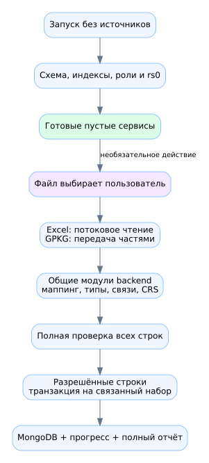

# Независимая инициализация и необязательный импорт — 0.10.0

## Два независимых действия

`manage.py up --connections --local-api` подготавливает MongoDB, rs0, пустые
коллекции, валидаторы, индексы и роли, затем запускает backend/dashboard.
Никакие пользовательские файлы для этого не нужны. QGIS устанавливается отдельно
как настольный клиент и подключается к готовому backend. В существующей БД команда
сохраняет документы; «пустые коллекции» создаются только там, где их ещё нет.



`excel-import` остаётся одноразовым сервисом профиля import и запускается только
явной командой. Его образ не собирается обычным up. Папка `data` и manifest
больше не используются. Постоянные mongo_data/mongo_config имеют прежние имена;
том импорта сохраняет GPKG, XLSX staging и SQLite-прогресс.

## Проверка установки без источников

1. Разверните отдельную новую установку по README. Не подменяйте `.env` рабочей БД.
2. Проверьте `manage.py verify/status`, `/health/ready` и вход в dashboard.
3. В QGIS подключитесь с API-токеном, выберите все коллекции и загрузите их:
   получите 17 пустых слоёв/таблиц со схемой; Geodata — Point EPSG:4326.
4. В консоли `db.Patient.countDocuments({})` и `db.Geodata.countDocuments({})`
   должны вернуть 0. В старой установке они возвращают прежние количества.
5. Не импортируйте файл, если данные пока не нужны. Пустой журнал/карта — допустимы.

Проверка готовности подтверждает подключения и доступ, а не обязательное наличие
пациентов. Сохранённые A/B, маркеры cases, правки QGIS и предыдущие задания не удаляются.

## Строгий Excel: подготовка листа

Формат `records` предназначен для новых данных: одна строка — набор связанных
сущностей, первая строка — имена целевых полей. Для полного набора минимальны:

| Столбец Excel | Пример | Условие |
|---|---|---|
| Patient.passport | `0001234567` | Текстовая ячейка, сохранить ведущие нули |
| Patient.age | `25` | Целое 0–130, не пустая строка |
| Patient.reg_date | `2026-11-14` | ISO-дата/дата Excel |
| Instances.date | `2026-11-14` | Обязательно |
| Therapy.date_start | `2026-11-14` | Обязательно |
| Therapy.diagnosis | `["A15.0"]` | Непустой список диагнозов |
| Geodata.Longitude | `30.0` | Долгота EPSG:4326 |
| Geodata.Latitude | `60.0` | Широта EPSG:4326 |

Вместо координат допустима полная адресная цепочка согласно бизнес-правилам
backend: Region/Municipality/Settlement/Street/Building, со всеми требуемыми
атрибутами. Геокодирование не выполняется автоматически. `_id`, instance,
владение и внутренние метаданные не вводятся — backend генерирует ключи и связи.
Для отдельных коллекций выберите `--mode entities`; обязательны поля выбранных
сущностей. При ссылке на существующий документ передавайте доступный ObjectId
в соответствующем поле, например Therapy.patient. Несуществующий/чужой ключ — ошибка.

Выберите лист `--sheet Cases`; без параметра используется первый лист. Пустые
строки без значений пропускаются как оформление, строки с частичными значениями
полностью проверяются. Исходный номер строки Excel сохраняется в `source_key`
отчёта; `row` — порядковый номер непустой строки данных. Заголовки должны быть
уникальными и непустыми. Формулы не исполняются и не подменяются кешированным
результатом: передайте явные значения в отдельной копии файла.

## Явный запуск Excel

PowerShell из корня проекта:

```powershell
py scripts/import_excel.py "D:\Sources\records.xlsx" --sheet Cases
py scripts/import_excel.py "D:\Sources\records.xlsx" --sheet Cases --apply > import-report.jsonl
```

Первая команда только проверяет все строки и внешние ключи. Вторая проверяет и
записывает. Образ импортёра собирается по явной команде, исходный путь монтируется
read-only в `/input/source.xlsx`. Путь может содержать пробелы/кириллицу.
Linux/macOS: `python3 scripts/import_excel.py "/path with spaces/records.xlsx"`.
Файл должен быть доступен Docker Desktop для чтения. Исходник не переносится в Git.

Частичный режим:

```powershell
py scripts/import_excel.py "D:\Sources\records.xlsx" --sheet Cases --mode entities --error-policy partial --apply > import-report.jsonl
```

Для работы без Docker можно установить зависимости backend и вызвать
`python -m app.modules.import_excel /absolute/path.xlsx --apply` из папки backend,
задав технические параметры MongoDB в окружении. Простого наличия `.env` при
прямом вызове Python недостаточно: Compose загружает его только в контейнеры.
Не публикуйте секреты в отчёте/командной строке.

Движение данных: потоковое чтение одного workbook → дисковая таблица во временном
служебном файле → общий маппинг/валидация `gpkg_import` → `gpkg_jobs` → транзакции
связанных строк в `entities`. Геометрия по координатам вычисляется в backend.
Служебная таблица — внутренний формат, а не новый пользовательский файл GPKG.

Полный JSONL-отчёт выводится в stdout: первая строка содержит summary, далее идут
все сообщения постранично. Ошибка даёт ненулевой код завершения. Прогресс сборки
образа перенаправлен в stderr. Не ограничивайте отчёт только первыми 100 сообщениями.
При позднем сбое сохраните job_id; продолжение возможно через существующий jobs
API с тем же владельцем qgis-user, исходником и томом импорта. Повтор команды для
неизменённого файла создаёт новое задание, но использует прежние детерминированные
ID и не создаёт дубликатов. Изменившийся файл имеет другую идентичность.

## Прежний формат «лист — коллекция»

Исторический адаптер сохранён отдельно: листы названы именами коллекций, поля
соответствуют модели, старые ID/FK нормализуются через namespace. Это совместимость
с ранее использовавшимися неполными источниками, а не обычный строгий пользовательский
ввод. У него прежнее архивирование исходных ячеек в cases; ошибки/пропуски выводятся
в отчёте, фиктивные паспорта или возраст не создаются.

```powershell
py scripts/import_excel.py "D:\Sources\old.xlsx" --format collections --namespace test-dataset-a
py scripts/import_excel.py "D:\Sources\old.xlsx" --format collections --namespace test-dataset-a --historical --apply
```

Сначала изучите план и резервную копию. Namespace должен совпадать с прежним импортом,
если нужно сохранить ID. Старые неполные атрибуты/неразрешённые ссылки обрабатываются
как в историческом адаптере и отражаются в отчёте; правила strict/partial нового
jobs API к этому пути не применяются. Не используйте исторический адаптер для обхода
проверок новых записей. Этот административный путь требует доступа к секретам хоста.

`seed_b.execute(path, digest, store)` сохранён как прежний адаптер внешнего JSON.
Он не вызывается при запуске. Произвольный JSON-upload через UI не добавлен.

## GeoPackage

Файл выбирается кнопкой плагина. Передача частями и пакетная обработка не ограничивают
полный объём. Сохраняются выбор таблицы, частичный маппинг, strict/partial, проверка
CRS, geometry и связей, CSV со всеми ошибками и безопасное продолжение.
Подробная [политика ошибок](GPKG_ERROR_POLICY_090.md) остаётся действующей.

Во всех новых строгих путях до конца проверки нет записи. Транзакция при записи
охватывает одну строку и связанные документы, а не весь файл. При позднем сбое
ранее подтверждённые строки остаются и учитываются в отчёте.

## Git и существующие данные

В поставке нет `.xlsx`, `.gpkg`, исходных A/B и manifest. `.gitignore` исключает
локальные датасеты; модель и конфигурация остаются частью проекта. Если старые
датасеты уже отслеживаются вашим репозиторием, `.gitignore` не убирает их из индекса.
Сначала сохраните исходники по внешнему пути, затем в своём репозитории выполните:

```powershell
git rm --cached --ignore-unmatch -- data/test_datasetA.xlsx data/testB_normalized.json data/manifest.json
git status --short
```

Зафиксируйте новые исходники и правила исключения обычным коммитом. История Git
автоматически не переписывается; предыдущие коммиты могут содержать источники.
В этой поставке нет связанного `.git`/remote, поэтому push и очистка истории
удалённого репозитория не выполнялись. Документы MongoDB и volumes эти команды
не затрагивают. Не используйте удаление томов для «пустого старта» рабочей БД.

## Память и производительность

Backend читает для dashboard только реально используемые поля и ограничивает
страницы числом строк/байтами. Аналитик по-прежнему получает все страницы.
Dashboard запрашивает до 1000 строк за страницу вместо 500; user/guest сохраняют
прежнюю границу интерфейса 2500. При слишком длинных записях страница меньше;
следующий курсор соответствует последней включённой строке.

Кеш внешних ключей ограничен 1024 элементами / 1 МиБ учтённого содержимого и живёт
только одну страницу проверки. Накладные расходы объектов Python добавляются к
этому размеру. В момент записи права/ссылки проверяются заново без этого кеша.
Кеш CRS ограничен 32 преобразованиями. QGIS создаёт QgsFeature пакетами по 256,
использует один общий словарь документов для редактора/слоя и не накапливает
временный список всех имён полей. Память самого полного слоя остаётся пропорциональна
его размеру; dashboard хранит полную выборку аналитика, поэтому клиентская память
не является постоянной при неограниченном росте данных.

Измерения и методика: [OPTIMIZATION_0100.md](../tests/OPTIMIZATION_0100.md).
