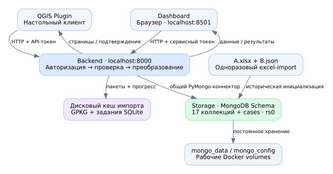
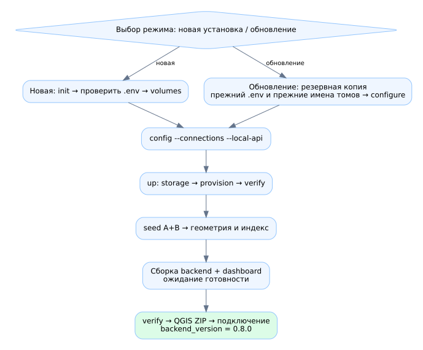
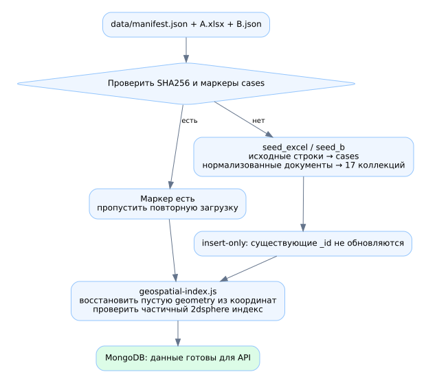
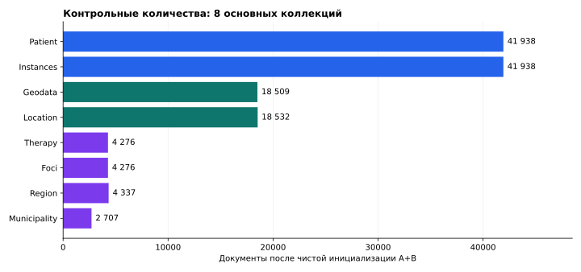
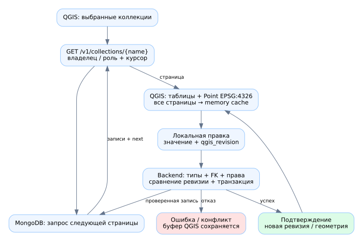
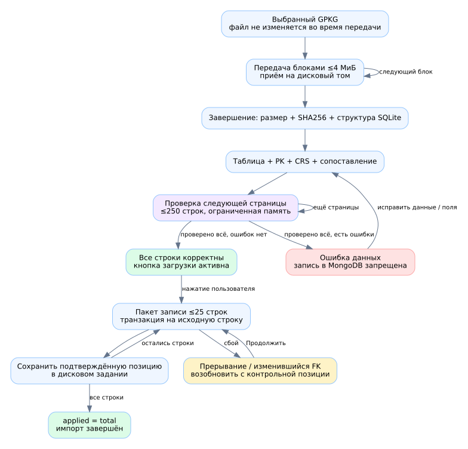
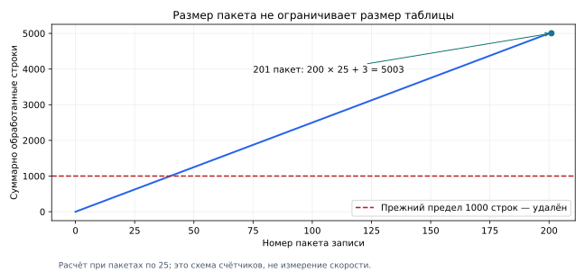

# Подробная инструкция для студента

GIS-MongoDB 0.8.0 · редакция 11.11.2026. Выполняйте практикум на отдельной учебной
установке. Не используйте рабочую БД для проверочных вставок. Все примеры пациентов
здесь условные; реальные персональные данные в отчёт не включаются.

Связанные материалы: [общая инструкция](OPERATIONS.md), [каждый скрипт](SCRIPT_REFERENCE.md),
[README](../README.md), [единый HTML](MANUAL.html). Сначала прочитайте этапы 1–4;
не запускайте встреченные в исходниках файлы наугад.

## 1. Что мы собираем и как движутся данные



В системе есть три типа действий. При чтении QGIS/dashboard запрашивает backend,
тот читает MongoDB и возвращает результат. При создании backend сначала проверяет
данные, затем записывает документы и их ссылки. При правке QGIS сначала изменяет
локальный буфер, а MongoDB обновляется только после подтверждённого сохранения.

| Где вы находитесь | Пример | Что это означает |
|---|---|---|
| Терминал хоста | PowerShell в папке проекта | Команды py и docker управляют установкой |
| Внутри контейнера | Bash после docker compose exec storage bash | Другая файловая система; /opt — путь контейнера |
| Окно QGIS | MongoDB Data Loader / таблица слоя | Настольный клиент, использующий backend |
| Браузер | Dashboard на порту 8501 | Интерфейс Streamlit |
| Консоль плагина | db.Patient.find({}) | Текст запроса в MongoDB-подмножестве, не системная оболочка |

Не вводите `py scripts/manage.py up` в консоль MongoDB и не вставляйте db.Patient
в PowerShell. В кодовых блоках ниже указано, где выполняется команда. Копируйте
команду без символов приглашения PS>, $ или >.

## 2. Откройте правильную папку

Полностью распакуйте архив. Внутри папки GIS-MongoDB должны находиться README.md,
docker-compose.yml и каталоги backend, storage, dashboard, qgis_plugin, scripts,
data, docs, tests, queries, dist. Не запускайте проект из просмотра ZIP и не
копируйте только scripts/manage.py отдельно от остальных файлов.

В Windows откройте папку в проводнике, запустите PowerShell/Terminal в этой папке.
Проверьте:

```powershell
Get-Location
Test-Path .\docker-compose.yml
Test-Path .\storage\schema\model.json
Test-Path .\data\manifest.json
```

Ожидается True в трёх проверках. Если False, перейдите именно в корень GIS-MongoDB.
В Linux/macOS используйте pwd и ls, а далее заменяйте py на python3.

## 3. Подготовьте программы

Запустите Docker Desktop/Engine. Python на хосте нужен для управляющего скрипта;
рабочие библиотеки backend устанавливаются в его Docker-образ. QGIS нужен для
настольного клиента. Node.js нужен при локальном запуске набора тестов, но не
для обычного открытия dashboard.

```powershell
py --version
docker --version
docker compose version
py scripts/manage.py doctor
```

doctor печатает версии Python/Node/Docker/Compose и сведения о daemon. Отсутствие
Node мешает тестам, но не само по себе развёртыванию. Ошибка доступа к Docker
означает проблему среды, а не необходимость сбросить БД. При необходимости
передайте преподавателю текст ошибки без .env и паролей.

Не пытайтесь установить PyQGIS обычным pip в Python проекта. Плагин выполняется
в среде Python, поставляемой вместе с QGIS. Это может быть другая версия Python,
чем у backend; смешивать их NumPy/бинарные библиотеки нельзя.

## 4. Определите режим: впервые или обновление



### 4.1. Если это новая отдельная учебная установка

```powershell
py scripts/manage.py init
```

Создаётся приватный .env с уникальными секретами и именами томов. Скрипт не должен
перезаписывать существующий .env. Сообщение о существующем файле — повод проверить
режим работы, а не удалить файл. Откройте .env локально и найдите имена
STORAGE_DATA_VOLUME/STORAGE_CONFIG_VOLUME; сохраните их в закрытой записи вместе
с резервной копией .env. Не вставляйте содержимое .env в отчёт.

Далее:

```powershell
py scripts/manage.py volumes
py scripts/manage.py config --connections --local-api
```

volumes создаёт отсутствующие data/config-тома указанной установки либо сообщает,
что использует существующие. config проверяет объединённую конфигурацию Compose;
он не доказывает, что сервер запущен или данные загружены. Ключ --local-api
применяют вместе с --connections. Для новой установки выполняйте шаги в этом
порядке, чтобы видеть, с какими томами работает проект.

### 4.2. Если у вас уже есть БД

Не выполняйте init. Сохраните старый .env и резервную копию данных. Замените файлы
поставки, оставив прежний .env в корне, затем:

```powershell
py scripts/manage.py configure
py scripts/manage.py config --connections --local-api
```

configure добавляет отсутствующие новые секреты, не меняя существующие. Он не
исправляет уже имеющийся неправильный пароль и не объединяет две разные БД.
До up сверяйте прежние имена томов. Не используйте новые случайные имена как
«ремонт»: это может скрыть старую БД за пустой установкой.

## 5. Запустите полный проект

```powershell
py scripts/manage.py up --connections --local-api
```

Это одна команда, но несколько последовательных этапов. Читайте результат каждого:

| Этап | Исполнитель | Ожидаемый результат |
|---|---|---|
| Проверка томов и остановка backend | manage.py | Нет другого работающего mongod на тех же томах |
| Старт storage | entrypoint.sh и Docker | Окончательный mongod доступен, контейнер Healthy |
| Replica set | replica.js | rs0 становится PRIMARY; возможны транзакции |
| Схема/роли/индексы | provision.js → schema.js/roles.js/indexes.js | Нужные коллекции, привилегии и индексы настроены |
| Прикладная проверка | verify.js | PASS; пароли приложения соответствуют БД |
| Источники A+B | seed.py → seed_excel.py/seed_b.py | Загрузка либо пропуск по уже существующему маркеру |
| Геометрия | geospatial-index.js | Валидные точки и пространственный индекс подготовлены |
| Backend/dashboard | Docker build и запуск | Готовые сервисы, порты доступны через local overlay |

Первый build может идти дольше повторного: Docker получает образы и устанавливает
зависимости. Не закрывайте Docker во время загрузки источников. При ошибке не
повторяйте init: сначала выясните, какой этап не завершился. Повтор up работает
с теми же .env/томами и insert-only seed.

Затем:

```powershell
py scripts/manage.py verify
py scripts/manage.py status
```

Откройте в браузере http://127.0.0.1:8000/health/ready. Успех backend не означает,
что любой конкретный пользователь имеет доступ ко всем данным; права проверим
отдельно. http://127.0.0.1:8000/ без /health/ready может не быть страницей сайта —
backend является API, а не пользовательским лендингом.

## 6. Разберите переход исходников в MongoDB



Откройте data/manifest.json: здесь указаны имена A/B, контрольные суммы и namespace.
Скрипт seed.py проверяет целостность файлов. Для A запускает seed_excel, для B —
seed_b. В cases попадают исходные строки/происхождение; в 17 коллекций —
нормализованные документы. Существующие документы не заменяются.

В sources могут отсутствовать паспорта и возраст B. Не вводите случайные значения,
чтобы сделать исторический набор «полным». Bootstrap сохраняет неполноту источника.
Новая интерактивная запись обязана пройти более строгие правила. Поэтому один и
тот же неполный источник нельзя автоматически считать корректным новым GPKG-вводом.



Контроль для чистой базы: Patient=41938, Instances=41938, Geodata=18509,
Location=18532, Therapy=4276, Foci=4276. После упражнений числа изменятся; сначала
зафиксируйте начальное состояние. В MongoDB можно видеть cases сверх 17 коллекций
каталога QGIS — это не ошибка количества.

## 7. Войдите в dashboard

Откройте http://127.0.0.1:8501. Выберите роль и пароль из соответствующей переменной:
Главврач/аналитик — ROLE_READER_PASS, пользователь — ROLE_USER_PASS, гость —
ROLE_GUEST_PASS. Это не QGIS-токены и не пароль root MongoDB.

Последовательно проверьте четыре вкладки: карту, графики, журнал и экспорт.
Установите фильтр и сравните число записей до/после. Для аналитика основная
выборка читается полностью; у user/guest интерфейс ограничен 2500 обращениями.
Режим отдельных точек имеет собственный экранный предел. Меньшее число точек
может означать отсутствие координат, фильтр или режим отображения, а не потерю
документов. При большом наборе переключитесь в кластеры.

После изменения данных overview может оставаться в кеше до 60 секунд; дождитесь
истечения TTL и повторного выполнения страницы. Для немедленного контроля используйте
Mongo-консоль/повторную загрузку QGIS, а не только старую карточку dashboard.

Журнал листается по 100 строк. CSV выгружает текущую фильтрованную выборку,
а не только видимые 100 строк. JSON/XML-консоль dashboard ограничивает отдельный
запрос до 200 результатов; это другой канал, чем полная выгрузка коллекций QGIS.
Демонстрационные spatial/analytics для /v1/tz-query сейчас берут одну страницу
экспорта; не используйте их как доказательство полного подсчёта всей БД.

## 8. Установите плагин QGIS

1. Откройте QGIS.
2. Найдите менеджер модулей → установку из ZIP.
3. Укажите dist/qgis_mongodb.zip из текущей поставки.
4. Если установлена предыдущая версия, переустановите ZIP и полностью перезапустите QGIS.
5. Откройте меню/кнопку **MongoDB Data Loader**. Старый параллельный плагин отключите,
   чтобы не работать сразу с двумя разными окнами.

Не выбирайте полный архив GIS-MongoDB вместо dist/qgis_mongodb.zip. Не открывайте
qgis_plugin/*.py двойным щелчком — это внутренние модули плагина.

## 9. Заполните подключение

| Поле окна | Что указать локально | Типичная ошибка |
|---|---|---|
| Хост | 127.0.0.1 | Ввод storage: это имя Docker-сети, не адрес настольного QGIS |
| Порт | 8000 | Ввод 27017/27018, то есть порта MongoDB вместо HTTP API |
| База | Schema, поле фиксировано | Попытка создать другую БД вводом имени |
| Пользователь | qgis-user / analyst / guest / admin | Смена имени без токена той же роли |
| API-токен | QGIS_USER_TOKEN / DASHBOARD_TOKEN / QGIS_GUEST_TOKEN / QGIS_ADMIN_TOKEN | Пароль dashboard или MongoDB вместо токена |

Нажмите «Подключиться». В строке состояния должны быть роль, владелец,
количество доступных коллекций и backend: 0.8.0. У guest — 13, у остальных
стандартных профилей — 17. Если версия не сообщается или старее, сначала обновите
backend вместе с ZIP. Локальный HTTP разрешён; удалённый backend клиент требует
по HTTPS. Сам проект не настраивает для вас внешний HTTPS/reverse proxy.

При смене профиля прежние управляемые слои убираются из проекта, права запрашиваются
заново. Если есть несохранённый буфер, сначала решите, сохранить его или отменить.
Права не увеличиваются от введённого вручную слова admin.

## 10. Выгрузите все коллекции

Отметьте «Выбрать все» либо нужные флажки. Нажмите «Загрузить выбранные коллекции
полностью». Дождитесь завершения, проверьте число ошибок. Во время загрузки
клиент читает страницы, а не останавливается на первой странице.



В панели слоёв Geodata имеет геометрию Point EPSG:4326. Patient и другие коллекции
представлены обычными таблицами без геометрии — это правильное поведение.
Откройте таблицу атрибутов каждого контрольного слоя и сравните количества с
MongoDB через countDocuments. Пустая коллекция должна добавляться как пустая таблица.

Служебный _key нужен для адресации документа с любым поддерживаемым типом _id.
Не редактируйте _id, _key, instance, qgis_revision. Вложенные структуры/массивы
часто видны строкой JSON: это транспортное представление, а не изменение
исходного BSON-типа в MongoDB.

## 11. Проверьте Geodata отдельно

В консоли плагина выполните по очереди:

```javascript
db.Geodata.countDocuments({})
db.Geodata.countDocuments({"geometry.type":"Point", "geometry.coordinates.1":{$exists:true}})
db.Geodata.find({$or:[{geometry:{$exists:false}},{geometry:null},{geometry:{}}]}).limit(10)
```

В чистой исходной базе первые два значения — 18509, третий запрос не должен
возвращать строки. После импорта абсолютное число изменится, сравнивайте
согласованность, а не требуйте всегда 18509.

Проверьте у нескольких объектов четыре вещи: атрибут Longitude, атрибут Latitude,
сохранённый JSON geometry и реальную геометрию слоя QGIS. Пример точки:

```json
{"type":"Point","coordinates":[30.3,59.9]}
```

30.3 — долгота, 59.9 — широта. Не меняйте порядок по привычке из записи
«широта, долгота». Надпись CRS проекта в правом нижнем углу QGIS не доказывает,
что исходный файл имеет эту CRS.

Если поле geometry старых записей пусто, в терминале хоста:

```powershell
py scripts/manage.py geometry
```

Затем заново загрузите Geodata в плагине. Эта команда использует реальные
координаты и сохраняет прежнее пустое значение. При неверных/отсутствующих
координатах она не создаёт вымышленную точку. Не заполняйте всем объектам [0,0]
ради исчезновения предупреждения. Внешне отрисованная backend точка и наличие
сохранённого поля в MongoDB — разные проверки, поэтому проверяются обе.

## 12. Выполните пользовательские запросы

Откройте «Консоль MongoDB». Вставьте запрос в редактор и нажмите выполнение.
Редактор отправляет введённый текст, а не всегда стандартный пример.

| Задача | Запрос |
|---|---|
| Несколько пациентов | `db.Patient.find({}).limit(5)` |
| Фильтр и сортировка | `db.Patient.find({age:{$gte:40}}).sort({age:-1}).limit(20)` |
| Подсчёт без ограничения первой страницей | `db["Patient"].countDocuments({age:{$gte:40}})` |
| Разные возраста | `db.getCollection("Patient").distinct("age")` |
| Агрегация | `db.Instances.aggregate([{$group:{_id:"$patient",n:{$sum:1}}},{$sort:{n:-1}}])` |
| Regex | `db.Geodata.find({"geometry.type":/^Point$/i}).limit(5)` |

Пространственный пример, расстояние задаётся в метрах для этого GeoJSON-запроса:

```javascript
db.Geodata.find({geometry:{$near:{$geometry:{type:"Point",coordinates:[30,60]},$maxDistance:10000}}}).limit(10)
```

Для поля _id типа ObjectId используйте `ObjectId("24-символьное-hex-значение")`
с настоящим идентификатором документа. Простая строка с теми же символами —
другой BSON-тип и может не найти документ. Не копируйте текст заполнителя как ID.

Если результатов больше страницы, нажимайте «Следующая страница результата».
pretty() и toArray() поддерживаются как оформление, но не заставляют сервер
выдать всю БД одним ответом. Курсор консоли истекает после 15 минут без продолжения.
Для повторного полного запроса выполните его заново.

Ошибочный запрос должен показывать ошибку, не создавать пустой «успешный» результат.
Не используйте import os, print произвольного Python, $out/$merge или попытки
изменить роль в теле запроса. Для проверки прав подключитесь guest и запросите
Social_group: ожидается отказ, а не пустая таблица, выдаваемая за отсутствие данных.

## 13. Создайте учебный связанный набор

Проводите упражнение только в учебной БД. Для новой клинической записи нажмите
«Новая запись»; откроется форма «Новый связанный набор» с request_id. Сохраните
автоматически созданный request_id и заполните entities. Пример entities:

```json
{
  "Geodata":{"Longitude":30.3,"Latitude":59.9},
  "Instances":{"date":"2026-11-11"},
  "Patient":{"passport":"TRAINING-001","age":25,"reg_date":"2026-11-11"},
  "Therapy":{"date_start":"2026-11-11","diagnosis":["TRAINING"]}
}
```

Это условные значения для обучения, не клиническая запись реального пациента.
Вставьте этот объект вместо entities внутри полного шаблона; не удаляйте
request_id. diagnosis — массив, age — число без кавычек, даты — ISO-строки,
passport — строка для сохранения ведущих нулей. Нажмите проверку/отправку.

Должны создаться также Location и Foci; Patient–Therapy–Instances и местоположение
связываются автоматически. Найдите Patient по TRAINING-001, запишите его _id
в закрытом учебном протоколе и проверьте ссылки через чтение. Не вводите ID руками
в форме полного набора. Удалите одно обязательное поле и убедитесь, что запрос
отклоняется, а не создаёт неполный новый случай. Для нового отличающегося набора
нужен новый request_id; повтор прежнего с другим содержимым вызывает конфликт.

Адресная альтернатива требует все пять групп: Region, Municipality, Settlement,
Street, Building. В полном режиме нужны все описательные поля этой цепочки:
Region.name, Municipality.name, Settlement.name/type, Street.name,
Building.house/corpus/edificate/fraction/letters. Числовые поля Building остаются
целочисленными по model.json; не подменяйте отсутствующее значение выдуманным нулём.
Наличие адреса без координат не даёт точку на карте: геокодирование не реализовано.

## 14. Подготовьте собственный GPKG

Нужен завершённый файл GeoPackage со стабильным первичным ключом таблицы, например fid.
Выбранная геометрия должна быть 2D Point, а CRS — реально определённой. Polygon,
LineString, MultiPoint и произвольные 3D-геометрии текущий импорт не поддерживает.
Если в файле несколько таблиц, импортируется выбранная, затем можно обработать другую.

В QGIS заранее откройте исходную таблицу и проверьте число строк, тип геометрии,
CRS и отсутствие NULL в обязательных полях. Завершите редактирование файла перед
передачей. Переименование CRS не заменяет корректное преобразование координат.
Для непространственной таблицы достаточно атрибутов; флажок геометрии в диалоге
будет недоступен. Не добавляйте ненужные фиктивные координаты.

### 14.1. Минимальные варианты сопоставления

| Что создаём | Сопоставляем | Что не требуется |
|---|---|---|
| Только точки Geodata | Флажок реальной Point-геометрии; либо Longitude/Latitude | Patient/Instances/Therapy |
| Только Patient | passport, age, reg_date | Геометрия и остальные коллекции |
| Therapy с существующим пациентом | date_start, diagnosis, patient с доступным _id | Новый Patient, если ссылка уже существует |
| Patient + Geodata | Три обязательных поля пациента + Point/координаты | Instances/Therapy в режиме отдельных коллекций |
| Полный связанный набор | Четыре группы обязательного ввода | Ручные Location/Foci/_id |

Одна строка GPKG может порождать несколько связанных документов. Число документов
во всех коллекциях вместе поэтому не обязано равняться числу строк файла.

## 15. Выполните пакетный импорт GPKG



1. В плагине нажмите «Загрузить файл .gpkg в MongoDB».
2. Выберите файл. Плагин передаёт блоки до 4 МиБ, а backend сохраняет их на диск.
   Не закрывайте/не изменяйте исходный файл в процессе передачи.
3. После передачи дождитесь списка таблиц. Выберите нужную и проверьте показанное число строк.
4. Выберите «Отдельные коллекции — частичное сопоставление» либо полный режим.
5. Сопоставьте реальные исходные столбцы с целевыми полями. Оставьте ненужные
   назначения в состоянии «не сопоставлено». PK и служебные поля генерирует backend.
6. Если нужна Point-геометрия таблицы, оставьте флажок. Не путайте её с текстовым
   атрибутом geometry, который мог появиться при экспорте JSON из MongoDB.
7. После паузы ввода примерно 0,7 секунды начинается проверка. Можно нажать
   «Проверить все строки сейчас». Смена назначения сбрасывает предыдущее подтверждение.
8. Дождитесь конца **всех** страниц. Обязательные поля, типы, доступность FK и CRS
   проверяются сервером. Ошибка последней строки тоже запрещает начало записи.
9. После успеха нажмите «Загрузить в MongoDB». Наблюдайте «загружено X из N».
10. Завершение — X=N и сообщение об окончании. Проверьте MongoDB и перечитайте
    затронутые коллекции в QGIS.

Необязательные значения NULL/пустая строка пропускаются. Обязательное поле от этого
не становится необязательным. Если все сопоставленные обязательные атрибуты выбранного
Patient пусты, строка отвергается; backend не должен молча импортировать только её точку.



4 МиБ, 250 проверяемых строк, 25 записываемых строк — размеры шагов. Это не общий
предел файла. В тесте 5003 строки прошли из файла 43589632 байта. Размеры отдельных
ячеек/строк и тип геометрии всё равно ограничены; без свободного диска продолжение
невозможно. Неисправность «1..1000 rows» означает старую версию backend или плагина.

## 16. Продолжите прерванный импорт

Если окно закрыто или связь пропала, не создавайте сразу новый отличающийся файл.
Вновь откройте диалог под тем же подключением/владельцем и нажмите
«Продолжить после прерывания». Плагин восстановит сохранённое задание. Сервер
определит, сколько строк действительно подтверждено; число последней надписи на
экране может отставать от последнего завершившегося запроса.

При paused прочитайте номер и причину: например, FK перестал быть доступным после
проверки. Исправьте причину и продолжите тот же job. Подтверждённые строки не
откатываются, непрошедшая строка не пропускается. Повтор завершённого задания не
добавляет те же документы заново.

Это не дедупликация любых похожих файлов. Новый файл с другим содержимым или
другими PK может породить новые документы. Не меняйте сопоставление во время
частичного импорта ради «дозагрузки»: прежние ID с другим содержимым дадут конфликт.
Через 7 дней неактивности служебная сессия истекает; выберите файл заново, сохраняя
понимание уже записанных документов. В отчёт можно записывать job_id, но не токены.

## 17. Отредактируйте данные и проверьте синхронизацию

Выберите свой учебный Patient и включите обычное редактирование таблицы QGIS.
Измените age, сохраните. Выполните find по _id или тренировочному passport и
проверьте значение в MongoDB. При необходимости загрузите слой заново и сравните.
Затем отдельно проверьте изменение Longitude: backend должен согласовать geometry.

Вложенные объекты и массивы удобнее изменять JSON-формой «Изменить выбранную».
Выберите ровно одну запись. Не удаляйте служебные идентификаторы и не меняйте
qgis_revision. Не открывайте одновременно независимые правки одного документа,
не понимая конфликтов: старый номер ревизии приводит к 409 и требует сверки.

Для учебной проверки откажитесь от некорректного возраста 140: сервер должен
отклонить сохранение, а буфер остаться редактируемым. Исправьте значение, затем
повторите сохранение. У аналитика/гостя слой должен быть только на чтение.
Карандаш QGIS не должен служить способом обойти роль.

Обычное добавление/удаление строк memory provider не предусмотрено. Не путайте
удаление слоя из проекта с удалением документа MongoDB: первое убирает локальное
представление, второе API вообще не предоставляет.

## 18. Экспортируйте пространственные и непространственные данные

В панели QGIS выберите слой/таблицу → экспорт → «Сохранить объекты как…» → GeoPackage.
Назначьте файл и уникальное имя таблицы. Проверьте, не включён ли экспорт только
выбранных объектов, если требуется всё содержимое. Для Geodata сохраняйте
корректную CRS; для Patient не добавляйте искусственную геометрию.

Откройте полученный GPKG как новый источник в QGIS. Сравните число строк с
исходным слоем, проверьте несколько полей и Point. Несколько коллекций можно
сохранять разными таблицами в одном GPKG, добавляя таблицы, а не перезаписывая
случайно весь файл. Такое копирование не превращает GPKG в постоянно синхронизируемую
реплику MongoDB: дальнейший импорт — отдельное действие со своими правилами.

## 19. Разберите каждый управляющий вызов

Ниже полный список действий manage.py. Код самого диспетчера не является API-сервером.

| Действие | Что делает | Когда выполнять / эффект |
|---|---|---|
| doctor | Проверяет доступность инструментов и Docker daemon | Начальная диагностика; не меняет БД |
| plan | Печатает исторический реестр connections() | Не считать результатом live-проверки: там есть устаревшие статусы planned |
| init | Эксклюзивно создаёт .env | Только новая установка |
| configure | Дописывает отсутствующие ключи | Обновление старой установки; секреты не ротирует |
| volumes | Создаёт отсутствующие указанные тома | Явная подготовка новой установки; не поиск старых данных |
| config | Проверяет Compose | До старта; допускает --connections/--local-api/--emergency |
| up | Подготовка storage, seed, геометрии, запуск сервисов | Основной запуск; с --connections --local-api для QGIS/dashboard |
| status | Показывает compose ps -a | Проверка сервисов |
| logs | Последние 100 строк storage | Логи MongoDB, не приложения |
| stop | Останавливает dashboard/backend/storage | Обычное завершение, тома остаются |
| verify | Выполняет /opt/storage/verify.js | Проверка схемы/прав/индексов; storage уже должен работать |
| provision | Выполняет provision.js | Повторная настройка работающего storage; изменяет служебную конфигурацию |
| geometry | Выполняет geospatial-index.js | Восстановление пустой geometry и индекс |
| migrate-plan | План миграции старых названий | Останавливает backend, не применяет переименование |
| migrate | Применяет миграцию | Только после изучения плана/копии; затем обычный up |
| network-test | Read-only probe через тестовый overlay | Проверка соединения; не доказательство полноты всей БД |
| test | Python unit + три JS mock-набора | Нужны локальные зависимости и Node.js |
| integration | Отдельный случайный Docker-проект | Пишет только в свои тестовые тома и удаляет их после; нужен Docker |

--local-api требует --connections. --emergency публикует MongoDB только на localhost
для диагностики; обычному QGIS прямой порт MongoDB не нужен. Не включайте его
ради исправления HTTP-токена. После migrate/migrate-plan backend не возвращается
автоматически в прежнее состояние — выполните обычный up.

## 20. Прочитайте исходники по ходу данных

Откройте [полный справочник](SCRIPT_REFERENCE.md). Рекомендуемый порядок чтения:

1. manage.py и docker-compose.yml: какие процессы запускаются.
2. entrypoint → bootstrap/provision → schema/roles/indexes/verify: как готовится MongoDB.
3. seed → seed_excel/seed_b → insert_missing: как появляется история A+B.
4. classFactory → mongodb_data_loader → диалог → api_client: как действие становится HTTP.
5. main → principals → records/entities → database/mongodb: как запрос авторизуется и выполняется.
6. gpkg_dialog → uploads → import → jobs → entities: полный путь большого файла.
7. layer_records/guarded_memory: как backend подтверждает обычные правки QGIS.
8. dashboard/app → export_data → components: как строятся карта и журнал.
9. tests и queries: чем подтверждается поведение и что относится к отдельному учебному каталогу.

sync.py — резервный модуль, не действующий механизм синхронизации. console.py — старый
парсер, /v1/console использует mongo_console.py. plan и некоторые docstring сохранены
с раннего этапа; для фактического маршрута проверяйте main.py и вызовы, а не только
название файла. Справочник отмечает эти различия для каждого файла.

## 21. Запустите проверки без повреждения учебной установки

На хосте для unit/static:

```powershell
py -m pip install -r backend/requirements.txt
py scripts/manage.py test
py scripts/check_project.py
```

Ожидается успешное завершение; отсутствие Docker не мешает unit, но отсутствие
Node мешает JS-части. Базовый отчёт 0.8.0 содержит 88 Python-тестов. Документационные
изменения не означают повторного полного испытания контейнеров.

```powershell
py scripts/manage.py integration
```

Эта команда сама создаёт отдельный случайный проект/секреты/тома. Остальные
файлы tests/integration не являются универсальными безопасными проверками рабочей
БД: они могут создавать документы и править возраст/геометрию. Не запускайте
comprehensive_http.py, bulk_qgis.py и подобные против рабочей установки.
Их запуск требует специальной одноразовой базы, токенов и, для GUI, PyQGIS.

queries/catalog.json и queries/run.mongosh.js — проверенный учебный каталог из
100 запросов, не произвольный пользовательский API. Его выполнение/сравнение
описывает отдельный [SEED_AND_QUERIES.md](SEED_AND_QUERIES.md). Результаты относятся
к исходному снимку и фиксированной дате, после упражнений совпадение чисел не гарантируется.

## 22. Завершение, обслуживание и учебный отчёт

Сохраните или осознанно отмените буферы QGIS. Дождитесь окончания импорта либо
зафиксируйте job_id для продолжения. Выполните:

```powershell
py scripts/manage.py status
py scripts/manage.py stop
```

Не удаляйте тома ради окончания занятия. Следующий запуск — up с прежними .env и
томами, а не init. Для backup/restore следуйте общей инструкции с администратором;
автоматического резервирования в проекте нет.

В отчёте студента приведите версию backend/плагина, схемы движения данных, начальные
и итоговые количества, один корректный запрос, одну ожидаемую ошибку, результат
GPKG-проверки/импорта, факт сохранения правки в MongoDB и вывод о причинах расхождений.
Скриншоты должны скрывать токены и персональные сведения. Для каждого опыта укажите,
какой компонент выполнял проверку: UI, backend, MongoDB, а не просто «программа».

Контрольные вопросы: почему порт 8000 отличается от 27017; зачем rs0 при одном узле;
почему 25 не является пределом строк; чем cases отличается от Patient; почему
geometry нельзя заменять нулями; что означает ревизия; какие данные остаются после
закрытия QGIS; почему Healthy не заменяет verify; как повтор сохраняет ID и почему
другой файл всё равно может создать похожие записи.

## 23. Проследите HTTP-этапы без изменения кода

Это раздел для объяснения трассировки. Обычный импорт выполняйте через UI,
не переписывайте вручную binary upload в учебном отчёте.

| Шаг | API | Что передаётся / возвращается | Ответственный скрипт |
|---|---|---|---|
| Подключение | GET /v1/session | Проверенная роль, владелец, каталог, backend_version | main + principals + records |
| Каталог | GET /v1/collections | Схемы и разрешённые коллекции | records.catalog |
| Страница | GET /v1/collections/Geodata?limit=200 | Записи/геометрия/next; следующий запрос использует after | records.page + geometry |
| Начало файла | POST /v1/gpkg/uploads | Размер и имя → upload_id и chunk_bytes | gpkg_uploads.begin |
| Блок файла | PUT /v1/gpkg/uploads/{id}/chunk?offset=N | Байты → подтверждённая received | gpkg_uploads.chunk |
| Завершение файла | POST /v1/gpkg/uploads/{id}/complete | Проверка полного файла → таблицы/поля/requirements | gpkg_uploads.finish |
| Задание | POST /v1/gpkg/jobs | upload_id/table/mapping/use_geometry/mode → job_id | gpkg_jobs.start |
| Страница проверки | POST /v1/gpkg/jobs/{id}/validate | checked/total, состояние и ошибки | gpkg_jobs.validate |
| Запись | POST /v1/gpkg/jobs/{id}/apply | applied/total, complete либо paused | gpkg_jobs.apply |
| Продолжение | GET /v1/gpkg/jobs/{id} | Сохранённая конфигурация/позиция | gpkg_jobs.status |
| Правка | PATCH /v1/collections/{name}/{key} | revision + changes → подтверждённый документ | entities.edit |
| Пакет правок | POST /v1/collections/{name}/batch | До 200 изменений → новые ревизии | entities.edit_batch |
| Консоль | POST /v1/console | code либо cursor → value/records/следующий cursor | mongo_console |

Состояния задания: validating — проверка; invalid — найденные ошибки запрещают
запись; ready — всё проверено; importing — применяются строки; paused — нужно
исправить причину/повторить; complete — applied=total. Номер upload_id относится к
файлу, job_id — к конкретному заданию с сопоставлением; это разные идентификаторы.

Для ручной read-only проверки подключения в PowerShell можно временно прочитать
только нужный токен из собственного .env, не печатая его:

```powershell
$token = (Get-Content .env | Where-Object { $_ -like 'QGIS_USER_TOKEN=*' }) -replace '^QGIS_USER_TOKEN=', ''
$headers = @{ Authorization = "Bearer $token"; 'X-GIS-User' = 'qgis-user' }
Invoke-RestMethod -Uri 'http://127.0.0.1:8000/v1/session' -Headers $headers
Remove-Variable token, headers
```

Пример рассчитан на стандартный .env, созданный init, с незаключённым в кавычки
значением QGIS_USER_TOKEN. Не подставляйте здесь пароль root. Отправлять токены
в URL или демонстрировать строку $token преподавателю не требуется.
