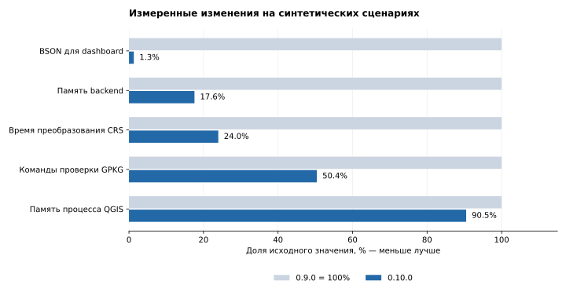

# GIS-MongoDB 0.10.0: изменения и проверка

14.11.2026. База сравнения — предыдущая поставка 0.9.0, SHA256 исходного архива
сохранён в `performance/environment.json`. Рабочие MongoDB/Docker volumes не
подключались. Все вставки/правки выполнялись только в одноразовых тестовых БД.

## Что изменено

| Участок | Изменение | Сохраняемое поведение |
|---|---|---|
| Запуск | Удалены обязательная сборка/запуск seed и повторный проход геометрии после него | provision по-прежнему создаёт rs0, схему, роли, индексы и проверяет геометрию существующих документов |
| Источники | A/B и manifest исключены из поставки; удалены их Git-ignore исключения | Документы и маркеры прежнего импорта остаются в MongoDB |
| Excel | Явный путь XLSX, потоковый records-формат через общий jobs API; прежний collections-формат вынесен в явный исторический режим | Типы, ID/FK, геометрия и строгий/частичный режим новых записей проверяются общими модулями |
| Дублирование | Удалена копия Excel-конвертеров, import_excel реэкспортирует общий код; общий кеш Transformer | Прежние oid/convert остаются доступны вызывающему коду |
| Dashboard backend | Проекции только необходимых полей, точные счётчики с индексными hint, исключены заведомо запрещённые guest-запросы и пустой Foci lookup | Возвращаемые аналитические записи идентичны, reader читает всю выборку |
| Dashboard клиент | До 1000 строк за запрос, без общего сброса кеша всех пользователей при входе/выходе | Роли по-прежнему разделены кеш-ключом, ручное обновление и TTL сохранены; user/guest — прежние 2500 |
| MongoDB | Дополнительные неуникальные индексы cases(owner,_id), Foci(owner,id_instance), Instances(owner,date) | Старые индексы не удаляются, схема/роли не меняются |
| GPKG preflight | Ограниченный кеш существующих ссылок на одну страницу проверки | При записи кеш не используется; права/FK проверяются заново |
| Пагинация | Байтовая граница overview с курсором последней реально включённой строки | Без скрытого пропуска и без общего лимита строк |
| QGIS | QgsFeature создаются пакетами по 256, поля перечисляются генератором, редактор использует словарь binding | Полные коллекции, неизвестные исторические поля, синхронизация и конфликты сохранены |
| Исторический XLSX | SQLite-курсор вместо fetchall при проверке ссылок | Исторические правила и архив cases сохранены |

Структура сервисов, `model.json`, направления ссылок, Bearer-аутентификация,
правила пользователя/гостя/аналитика и имена постоянных томов сохранены. Excel-import
получил доступ к тому же служебному тому импорта; исходный файл монтируется read-only
только по явному пути. Автоматического изменения Git remote/истории не выполнялось:
связанный репозиторий в исходной поставке отсутствовал. Команды удаления ранее
отслеживаемых датасетов из индекса приведены в инструкции.

## Сравнение производительности

Среда: Linux x86_64, Python 3.12, MongoDB 8.0.34 с аутентификацией/rs0,
PyQGIS 3.40.6. Обе версии использовали одну и ту же временную БД и оборудование.
Измерения не выполнялись в Docker с производственными лимитами CPU/памяти.

Фикстура: 4000 связанных обращений; в Patient/Therapy/Instances/Geodata добавлено
по 8192 байта неиспользуемого текста. Это намеренно проверяет стоимость чтения
лишних полей, а не представляет любой реальный медицинский набор. Исходные A/B
не использовались. Backend: прогрев, затем три измерения, в таблице медиана;
tracemalloc включён у обеих версий. BSON-объём измерен отдельным проходом, чтобы
кодирование диагностических ответов не искажало время. QGIS: отдельный процесс
на каждую версию, по одному замеру на 40000 синтетических строк.

| Показатель | 0.9.0 | 0.10.0 | Результат сценария |
|---|---:|---:|---|
| Полный overview, 4000 строк, страницы по 500 | 1,024 с | 0,952 с | Время меньше примерно на 7%; разница невелика и не является гарантией ускорения |
| BSON-ответы MongoDB для этого overview | 134,83 МБ | 1,76 МБ | −98,7% |
| Пик выделений Python на этом пути | 23,55 МБ | 4,14 МБ | −82,4%; это не полный RSS backend |
| Команды MongoDB на overview при равных страницах | 114 | 114 | Уменьшился объём данных, а не число запросов этого сравнения |
| Обработка 1000 геометрий с одинаковой исходной CRS | 0,161 с | 0,0386 с | Примерно в 4,17 раза быстрее за счёт повторного использования Transformer |
| Preflight GPKG, 1003 Therapy с одним существующим Patient | 1,187 с | 0,816 с | −31,3% времени |
| Команды MongoDB в этом preflight | 2013 | 1015 | −49,6%; кеш действует только внутри страницы |
| Создание QGIS-слоя, 40000 строк | 0,229 с | 0,193 с | Один замер, ориентировочно −16% |
| Пик RSS процесса QGIS, включая библиотеки | 229,7 МиБ | 207,8 МиБ | −9,5% |

Для overview и геометрий совпали SHA256 результатов до/после; проверка GPKG
приняла те же 1003 строки. Кеш не отменяет обязательные атрибуты/ссылки и не
подменяет данные. На обычных небольших документах выигрыш проекции будет меньше;
на неповторяющихся внешних ключах кеш может почти не помочь.

Параметр страниц dashboard в приложении теперь 1000, но сравнительный benchmark
специально использует одинаковые 500 у обеих версий. Измерения исходных значений,
все повторы, хеши и параметры: [results.json](performance/results.json),
[environment.json](performance/environment.json). Скрипты и порядок воспроизведения:
[performance/README.md](performance/README.md).

## Нагрузочная проверка API

96 запросов, четыре параллельных потока, роли reader/user/guest, endpoint коллекций,
overview и statistics. Ошибок — **0**. В этом коротком прогоне: около **91,4 запроса/с**,
медиана **26,3 мс**, p95 **110,7 мс**, суммарно **1,051 с**.
Это smoke-load новой версии на локальном backend, не длительный soak-тест и не
определение максимального числа пользователей. Сопоставимый HTTP-load старого
сервера не измерялся; сравнение до/после выше относится к отдельным путям.
Исходные числа — [load_results.json](performance/load_results.json).

План глубокой keyset-пагинации Geodata проверен через executionStats: для 100
возвращённых строк прочитано **100 документов / 100 индексных ключей**. Проверено
наличие трёх дополнительных индексов. План — [query_plans.json](performance/query_plans.json).

## Функциональная проверка

- **106 Python unit-тестов и три набора JavaScript mock-тестов прошли** через
  штатный `manage.py test`; AST/JS/JSON и структура поставки проверены отдельно.
- Настоящая пустая MongoDB: bootstrap/provision/verify, роли, индексы, rs0 и
  технические подключения работают без исходных файлов.
- Настоящий QGIS загрузил все 17 пустых коллекций со схемами; Geodata имеет
  EPSG:4326. Dashboard без данных открывается под reader/user/guest без ошибок.
- На синтетической заполненной БД проверены все 17 коллекций, полная пагинация,
  экспорт всех таблиц в GPKG и повторное открытие с теми же количествами.
- Правки атрибутов/геометрии QGIS сохраняются в MongoDB; неверный возраст сохраняет
  локальный буфер и не попадает в БД; reader остаётся read-only; смена пользователей
  обновляет права. Пользовательские find/aggregate/countDocuments/distinct и
  пространственные запросы прошли регрессию.
- Excel records на **1003 строки**, одна ошибка: strict — нулевые записи;
  partial — **1002** связанных набора / **6012** документов. Повтор — ноль новых
  документов; исходный XLSX побайтно не изменился, geometry и связи сформированы.
- Политики GPKG, необязательные NULL, неверные типы/FK/CRS и полная диагностика
  проверены. Реальная запись MongoDB с потерей подтверждения безопасно повторена;
  количество созданных документов восстановлено точно.
- Qt-диалог GPKG: 243 строки, partial записал 121 корректную строку / 242 документа;
  122 отклонения полностью выгружены в CSV, сверх preview-границы 100 ошибок.
- Повторно проверен GPKG **43 589 632 байта / 5003 строки** через настоящий QGIS:
  передача частями, полная загрузка, закрытие окна и продолжение, повтор без дублей.
  Ошибка последней строки блокирует всю запись strict-задания.
- Задание на 1003 Geodata пережило реальные перезапуски backend после первой
  страницы проверки и после первых 25 записей: итог ровно 1003, без пропусков/дублей.
- Страницы overview с длинными значениями проверены отдельно: все 4000 исходных
  строк выгружены по одному разу, каждый ответ меньше 1,6 МБ.
- `model.json`, спецификация ролей, bootstrap/миграции и конфигурация постоянных
  томов сохранены. Проверка Compose config выполнена с connections/import/local-api.
  Содержимое исходных датасетов не включено в новую поставку.

## Ограничения и обновление

Полный запуск Docker-контейнеров в этой среде **не подтверждён**: доступ к daemon
socket закрыт (`operation not permitted`). Конфигурация Compose проверена;
реальные MongoDB/backend/Streamlit/QGIS проверялись нативно. Windows/macOS GUI и
длительная нагрузка не тестировались. После обновления на своём хосте выполните
`manage.py verify/status` с прежним `.env` и volumes.

Полный слой QGIS и полная выборка аналитика всё ещё требуют памяти, пропорциональной
объёму. Общего ограничения строк не добавлено. Исторический JSON-адаптер `seed_b`
сохранён для явного административного использования и по-прежнему читает JSON целиком;
он не является новым потоковым пользовательским импортом.

Транзакция охватывает одну связанную строку. При позднем сбое подтверждённые строки
сохраняются; полного отката файла нет. Строгий режим запрещает запись при ошибках
полной предварительной проверки. Исторический collections-импорт — отдельный
совместимый административный путь, без новых гарантий strict/partial.

README, эксплуатация, инструкция студента, справочник скриптов, схемы и единый HTML
обновлены. Предыдущие отчёты 0.8/0.9 сохранены как история; их контрольные количества
не относятся к новой пустой установке. Источники, старые данные и volumes удалять
для обновления не требуется. Подробный переход: [UPGRADE.md](../docs/UPGRADE.md).
